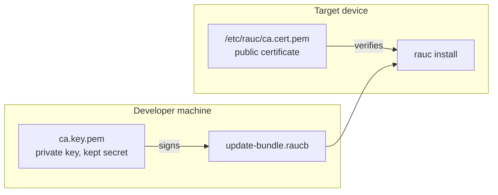
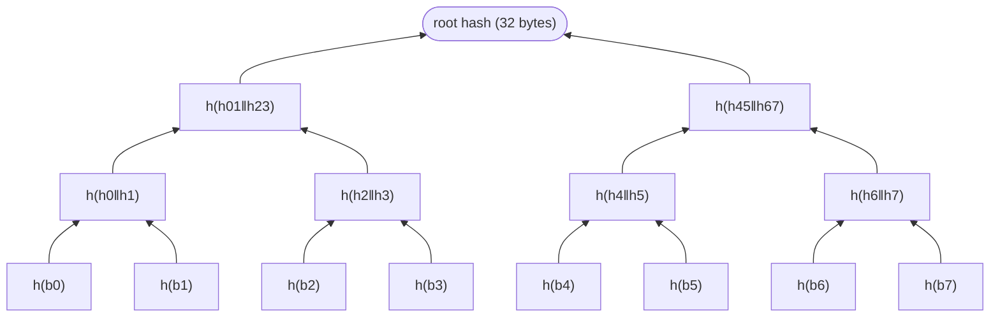
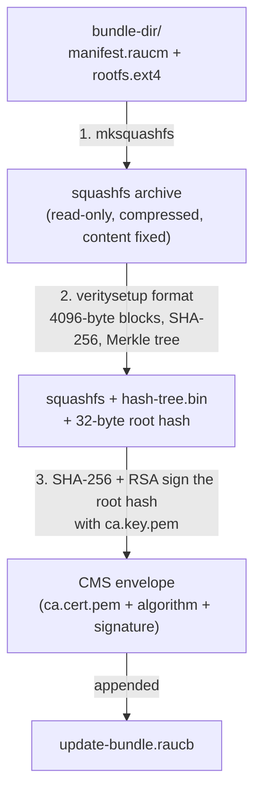
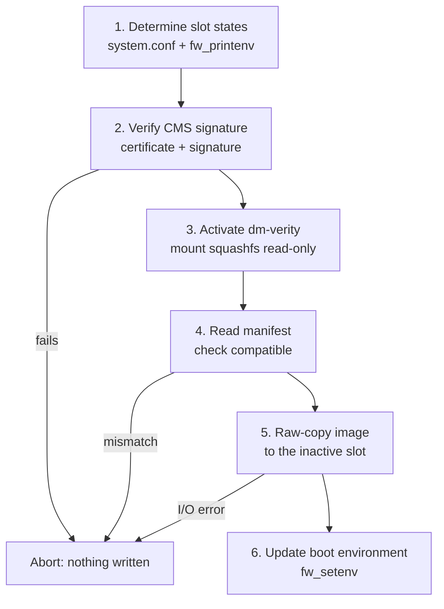

In [Part 1](/posts/understanding-rauc-ab-updates/) we saw how RAUC's A/B mechanism makes updates recoverable. This second part looks at the update **bundle** itself: how it is created, how its authenticity and integrity are protected, and how RAUC verifies and installs it.

## Concepts you need first

### Asymmetric cryptography and digital signatures

Secure update systems use a mathematically linked **key pair**:

- the **private key** (`ca.key.pem`) stays secret on the developer's machine and is used to **sign**;
- the **public key**, carried by the certificate `ca.cert.pem`, is embedded in the device image and is used to **verify**.

What is signed with the private key can only be verified with the matching public key, and the public key does not let you derive the private one.



Even an attacker who has the device and reads `ca.cert.pem` cannot modify a valid bundle without the private key.

RAUC uses asymmetric cryptography for **signatures**, not for encryption. Encryption hides content, while a signature proves **origin and integrity** without hiding anything.

1. **Signing** (developer machine): hash the content with SHA-256, then sign that hash with the private key and embed the result in the bundle.
2. **Verifying** (device): recompute the SHA-256 of the content, recover the signed hash using the public key, and compare. If they match, the bundle is authentic and unmodified. Otherwise it has been tampered with or forged.

Changing a single bit of the content produces a completely different hash, so the bundle cannot be altered without invalidating the signature.

### CMS: the signature envelope

A bare signature does not say which key or algorithm was used, or where it starts and ends. **CMS** (Cryptographic Message Syntax, RFC 5652, also known as PKCS#7) is a standard envelope that carries all of this, so any compliant tool (OpenSSL, RAUC, ...) can verify it without extra configuration. A CMS envelope contains:

- the **signer certificate** (public key and identity),
- the **signature algorithm** (SHA-256 with RSA),
- the **signature** itself,
- an optional timestamp.

Because the certificate travels inside the envelope, the bundle is self-contained. In a RAUC bundle the envelope is **appended after the squashfs archive**, which works because squashfs tolerates trailing data.

### Why the device still needs ca.cert.pem

If the certificate is already in the bundle, why keep a copy at `/etc/rauc/ca.cert.pem`? Because it is the **trust anchor**. Without it, an attacker could generate their own key pair, sign a malicious bundle, embed their own certificate, and the device could not tell it apart from a legitimate one. RAUC extracts the certificate from the CMS envelope and compares it with the one on the device. Unknown certificate means immediate rejection.

## Anatomy of a bundle

A RAUC bundle is a single `.raucb` file built on **squashfs**, a compressed, read-only filesystem. Read-only is essential: a writable archive could be changed after signing.

### The manifest

`manifest.raucm` sits at the root of the squashfs and describes the update:

```ini
[update]
compatible=raspberrypi4
version=v1.0
description=My first custom RAUC bundle
build=20260909192709

[bundle]
format=verity

[image.rootfs]
filename=core-image-minimal-raspberrypi4.rootfs.ext4
```

| Field | Role |
|-------|------|
| `compatible` | Must exactly match `compatible` in the device's `system.conf`. Otherwise RAUC refuses the installation immediately. |
| `version` | Informational only, not used for acceptance logic. |
| `description` | Human-readable, visible in `rauc info`. |
| `build` | Build timestamp. |
| `[bundle] format` | Bundle format (see below). Absent for `plain`. |
| `[image.rootfs] filename` | The image to install. The slot name (`rootfs`) is used to find the matching slot in `system.conf`. |

### Three bundle formats

| Format | Content | Protection |
|--------|---------|------------|
| `plain` | squashfs + CMS signature | The signature covers the whole squashfs. No per-block verification. |
| `verity` | squashfs + dm-verity hash tree + CMS signature | The signature covers the **root hash** of the tree, enabling per-block verification. |
| `crypt` | `verity` + encryption | Content is encrypted with a symmetric key, itself encrypted for the device. Protects confidentiality in transit and storage. |

`verity` offers the best balance of security and simplicity and is the recommended choice for new projects, as the RAUC documentation also notes.

### Structure of a verity bundle

```text
update-bundle-raspberrypi4.raucb
├── [squashfs filesystem]
│   ├── manifest.raucm
│   └── core-image-minimal-raspberrypi4.rootfs.ext4   (complete root filesystem image)
├── [dm-verity hash tree]
│   ├── Level N-1: hashes of hash blocks
│   ├── ...
│   ├── Level 1: hashes of data-block hashes
│   └── Level 0: SHA-256 of each 4096-byte block
└── [CMS envelope]
    ├── ca.cert.pem (embedded signer certificate)
    ├── Algorithm: SHA-256 with RSA
    └── Signature (signs the dm-verity root hash)
```

Three things to retain:

- **The squashfs is never modified** after creation. The hash tree and the CMS envelope are appended as trailing data.
- **The signature covers only the 32-byte root hash**, which summarizes the whole squashfs through the Merkle tree. Signing and verifying stay fast whatever the bundle size.
- **The bundle is self-describing.** A verifier only needs the device's `ca.cert.pem`: the certificate, algorithm, root hash and hash tree are all in the file.

## dm-verity

**dm-verity** is a Linux kernel feature (Device Mapper) that guarantees the integrity of a block device **at read time**. It intercepts each block read, checks it, and either returns the data or an I/O error if tampering is detected. The application never knows.

It comes with two constraints: the device must be **read-only** (any write would invalidate the hashes), and the hash tree must be computed **before** use and cannot be updated without recomputing it. Both fit an update bundle well.

### The Merkle tree

The data is split into fixed-size blocks (typically 4096 bytes) and each block is hashed with SHA-256. These hashes are the leaves (Level 0). Hashes are then combined in pairs and re-hashed, level after level, until a single **root hash** remains. Whatever the data size, the root hash is always **32 bytes**.

Simplified example with 8 blocks:



> This binary tree is a teaching simplification. Real dm-verity packs many hashes into each 4096-byte hash block (128 SHA-256 hashes per block), so the tree is much shallower.
{: .prompt-info }

The tree is stored as a flat binary file, `hash-tree.bin`, written level by level from the top down. In a verity bundle it is appended right after the squashfs, before the CMS envelope.

### Why sign the root hash and not the leaf hashes?

If only leaf hashes were stored, an attacker who can modify the storage could change **a data block and its leaf hash together**, and verification would pass without any key. The Merkle tree defeats this: changing a leaf changes its parent, then its grandparent, up to the root. The attacker would have to change the root hash, and the root hash is protected by the CMS signature, which cannot be forged without the private key.

### dm-verity during installation

With `RAUC_BUNDLE_FORMAT = "verity"`, RAUC activates dm-verity on the bundle file **before reading any content**. Every block of the squashfs read during installation is checked against the hash tree. This protects against corruption during network transfer, during storage on the device, and against tampering with the file.

## Creating a bundle

### 1. Keys and certificate

Generate a 4096-bit RSA key and a self-signed certificate valid for 10 years:

```bash
# private key
openssl genrsa -out ca.key.pem 4096

# self-signed certificate
openssl req -new -x509 -days 3650 \
    -key ca.key.pem \
    -out ca.cert.pem \
    -subj "/CN=My RAUC CA/O=MyCompany"
```

- `ca.key.pem`: private key, never leaves the build machine.
- `ca.cert.pem`: public certificate, installed on every target device.

> A software-generated key is fine for development. In production, keep the private key in a hardware security module (HSM) or an equivalent secure facility.
{: .prompt-warning }

### 2. The rauc bundle command

Put the manifest and the image in a directory:

```text
bundle-dir/
├── manifest.raucm
└── rootfs.ext4
```

```bash
rauc bundle --cert=ca.cert.pem --key=ca.key.pem bundle-dir/ update-bundle.raucb
```

Internally it runs three operations:



1. **Squashfs creation** (`mksquashfs`). Read-only is a prerequisite for integrity, and compression reduces the size, which matters for OTA transfers.
2. **Hash tree generation** (`veritysetup format`, verity format only). It produces `hash-tree.bin` and the 32-byte root hash, and appends the tree to the squashfs.
3. **CMS signature.** Rather than sign a file that may be several gigabytes, RAUC signs only the root hash (verity) or the squashfs hash (plain), then appends the CMS envelope.

## Installing on the device

The bundle is a single self-contained file, so any channel works (`scp`, HTTP/HTTPS, USB, ...). Then:

```bash
rauc install /tmp/update-bundle.raucb
```

RAUC runs a strictly ordered sequence designed so that either the installation completes or the device is left untouched:



**1. Determine slot states.** RAUC reads `system.conf` and queries the bootloader through `fw_printenv` to find the booted slot and the inactive one. It **never writes to the booted slot**.

**2. Verify the signature.** RAUC reads the CMS envelope at the end of the file, extracts the certificate and compares it with `/etc/rauc/ca.cert.pem`, then checks the signature over the signed root hash. If anything fails, the installation aborts and nothing is written.

**3. Mount the squashfs with dm-verity.** Using the embedded hash tree and the signed root hash, RAUC mounts the squashfs read-only through dm-verity. From now on, any corrupted or tampered block raises an I/O error, which RAUC treats as fatal.

**4. Read and validate the manifest.** RAUC reads `manifest.raucm` (verified transparently by dm-verity) and compares `compatible` with `system.conf`. A mismatch aborts the installation, which prevents installing a bundle built for one hardware variant onto another.

**5. Write the image to the inactive slot.** RAUC reads `rootfs.ext4` block by block, each block verified by dm-verity, and writes it straight to the partition (for example `/dev/mmcblk0p3` for slot B). It is a **raw block copy**, not a mounted filesystem, so the slot is a byte-for-byte copy of what was in the bundle.

**6. Update the bootloader environment.** After a successful write, RAUC activates the new slot:

```bash
fw_setenv BOOT_ORDER "B A"
fw_setenv BOOT_B_LEFT 3
```

`BOOT_ORDER` puts slot B first, and `BOOT_B_LEFT=3` gives the new system three boot attempts before U-Boot falls back to slot A.

What the user sees:

```text
  0% Installing
  0% Determining slot states
 10% Determining slot states done.
 10% Checking bundle
 10% Verifying signature
 20% Verifying signature done.
 20% Checking bundle done.
 20% Installing slot rootfs.1
 90% Installing slot rootfs.1 done.
 90% Updating boot environment
100% Installing done
```

## The complete update lifecycle

1. **Creation:** the developer packages the image and manifest, generates the integrity metadata and signs the bundle.
2. **Transfer:** the `.raucb` file reaches the device.
3. **Verification:** RAUC checks the signature and metadata, and for a verity bundle dm-verity verifies the content as it is read.
4. **Installation:** the image is written to the inactive slot, leaving the running system untouched.
5. **Activation:** RAUC updates the bootloader environment so the new slot boots next.
6. **Boot confirmation:** after the reboot, the system runs its health checks and calls `rauc status mark-good`. If that never happens, the bootloader falls back to the previous slot once the attempt counter is exhausted.

Two complementary mechanisms are at work. **Bundle verification** establishes trust in the update and protects its integrity. The **A/B mechanism** preserves the existing system and provides a way back, provided the bootloader fallback is configured correctly.

A valid signature does not mean the new software is bug-free. That is why boot confirmation remains essential.

## Conclusion

A reliable update mechanism needs more than writing an image to storage. It must establish **trust** in the update, protect its **integrity**, preserve a **recovery path**, and **confirm** that the new system really works. Together, signed bundles, dm-verity, A/B slots and boot confirmation form a secure and recoverable update process for embedded Linux.
