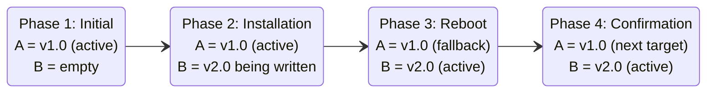
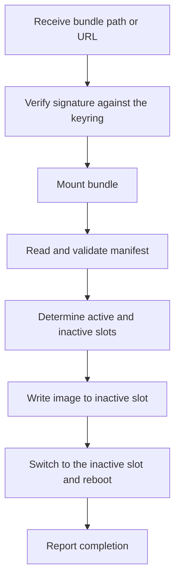

## The problem with classic updates

On a traditional embedded Linux system, an update downloads the new software, overwrites the existing files and reboots. On devices deployed in the field, this carries a risk that is easy to underestimate. It can fail in three ways:

1. **Power cut during the write:** the partition is half v1.0, half v2.0, and the system will not boot.
2. **Corrupted image:** corrupted data is written to the partition, and the system will not boot.
3. **Critical bug in v2.0:** the update completes, but the system crashes on every boot, with no way back to v1.0.

In every case the device ends up unusable, with no automatic recovery. The root cause is that a single-slot update is:

- **Destructive:** it overwrites the only copy of the running system.
- **Non-atomic:** it takes time, and during that window the system is neither the old version nor the new one.

A robust mechanism therefore needs three properties:

| Requirement | Meaning |
|-------------|---------|
| **Atomicity** | The update either happened completely or not at all. |
| **Reversibility** | If the new version fails, the system returns to the last known-good one automatically. |
| **Integrity verification** | The image is checked for authenticity and corruption before it is applied. |

## The A/B update mechanism

The principle is simple: **never overwrite the running system.** The device keeps two complete, independently bootable copies of the software, **slot A** and **slot B**. One is active and the other is free to receive the next update. Their roles swap after each successful update.



1. **Initial state:** the system runs from slot A (v1.0). Slot B is empty.
2. **Installation:** v2.0 is written to slot B while A keeps running. A power cut here leaves A untouched, and the system simply reboots into it.
3. **Activation:** once the installation is complete and verified, the bootloader is told to boot slot B next, and the system reboots.
4. **Confirmation:** after booting into B, the system confirms that v2.0 works. Slot A now holds the previous version and becomes the target of the next update.

## What is RAUC?

**RAUC** (Robust Auto-Update Controller) is an open source framework that manages software updates on embedded Linux. It implements the A/B mechanism and adds cryptographic verification. A RAUC system has four parts.

### The bundle

A single signed `.raucb` file containing everything needed to update a slot. It can travel by network, USB or SD card.

```text
update-bundle.raucb
├── manifest.raucm   ← what the bundle contains and which hardware it targets
├── rootfs.ext4      ← the new root filesystem image
└── signature        ← cryptographic proof of authenticity
```

A bundle targets a platform through the `compatible` string in its manifest, is signed with the developer's private key, and is verified by the device **before** any data is written.

### system.conf

The central configuration file on the device, installed at `/etc/rauc/system.conf`. It describes what the device is, which bootloader it uses and where its slots are. Example for a Raspberry Pi 4 with A/B rootfs slots:

```ini
[system]
compatible=raspberrypi4
bootloader=uboot

[keyring]
path=/etc/rauc/ca.cert.pem

[slot.rootfs.0]
device=/dev/mmcblk0p2
type=ext4
bootname=A

[slot.rootfs.1]
device=/dev/mmcblk0p3
type=ext4
bootname=B
```

| Section / field | Role |
|-----------------|------|
| `compatible` | Identifies the device. Must exactly match the `compatible` field of any bundle meant for it. |
| `bootloader` | Which bootloader backend RAUC uses to read and write boot variables. |
| `[keyring] path` | Certificate used to verify bundle signatures. |
| `device` | Block device or partition of the slot. |
| `type` | Filesystem or image type (`ext4`, `raw`, ...). |
| `bootname` | The name by which the bootloader identifies the slot (`A` or `B`). |

### The keyring

The trust anchor of the device: a standard X.509 certificate (typically `/etc/rauc/ca.cert.pem`). Only bundles signed with the matching private key are accepted. Any other bundle is rejected before anything is written.

### The RAUC service

The `rauc` service runs under systemd and performs the whole installation. When you call `rauc install <bundle>`, it goes through these steps:



At any time, `rauc status` returns the state of the system: which slot is booted, which slots exist and the boot status of each.

> A successful installation does not prove that the new system works. After rebooting, the system must explicitly confirm success with `rauc status mark-good` (see below).
{: .prompt-info }

## RAUC and the bootloader (U-Boot)

Two questions come up naturally:

1. How does the bootloader, which runs before Linux and knows nothing about RAUC, know which slot to boot after an update?
2. If the new version is broken, what stops the device from being stuck on it forever?

Both answers lie in a few **persistent bootloader variables** that U-Boot and Linux userspace can both access. We use U-Boot as the reference here.

### The communication channel

RAUC and U-Boot must exchange information across reboots. With U-Boot, this is the **environment partition**: a dedicated raw partition on the eMMC or SD card, with no filesystem and no mount point. U-Boot reads it at every boot, and RAUC reads and writes it through its U-Boot backend using `fw_printenv` and `fw_setenv`. These tools find the partition through `/etc/fw_env.config`.

### The three boot variables

| Variable | Role |
|----------|------|
| `BOOT_ORDER` | Slots in priority order, e.g. `A B` (try A first, B as fallback). Slots whose counter is zero are skipped. |
| `BOOT_A_LEFT` | Remaining boot attempts for slot A. |
| `BOOT_B_LEFT` | Remaining boot attempts for slot B. |

The counters are usually initialized to **3** when a slot is activated, either at image build time (slot A) or by RAUC after installing an update (the new slot).

> The actual initial value depends on the bootloader integration and its configuration.
{: .prompt-warning }

### Lifecycle of an update, from A (v1.0) to B (v2.0)

**Initial state**, running on slot A:

```text
BOOT_ORDER=A B
BOOT_A_LEFT=3
BOOT_B_LEFT=3
```

**After installation:** RAUC writes v2.0 to slot B without touching the running system, then updates the environment with `fw_setenv` before rebooting, so U-Boot always reads a consistent state:

```text
BOOT_ORDER=B A     ← B is now first
BOOT_A_LEFT=3      ← unchanged
BOOT_B_LEFT=3      ← reset by RAUC
```

**At the next boot,** U-Boot sees B first with a counter above zero, **decrements it and saves the environment before booting**:

```text
BOOT_ORDER=B A    → try slot B first
BOOT_B_LEFT=3 > 0 → decrement → BOOT_B_LEFT=2 → save env → boot slot B
```

Decrementing *before* the boot is intentional: if the system crashes before Linux even runs, the attempt has already been counted.

> This assumes your U-Boot boot script implements the decrement-and-save logic. The environment variables alone do not do it.
{: .prompt-warning }

### The fallback mechanism

If slot B never reaches a successful boot, each reboot consumes one attempt:

| Attempt | Counter |
|---------|---------|
| 1st | `BOOT_B_LEFT` 3 → 2 |
| 2nd | `BOOT_B_LEFT` 2 → 1 |
| 3rd | `BOOT_B_LEFT` 1 → 0 |

Once the counter hits zero, U-Boot skips B and moves to the next slot in `BOOT_ORDER`, which is A:

```text
BOOT_ORDER=B A
BOOT_B_LEFT=0
BOOT_A_LEFT=3
→ skip B, try A
```

The key point is that **the fallback is decided entirely by U-Boot.** Linux and RAUC do not need to be running. This requires the boot script to implement the counter logic and the other slot to contain a valid, bootable system.

### The role of the watchdog

The fallback assumes the system reboots after a failed boot. But if Linux starts and then hangs, or a critical service fails, nothing reboots the device unless a **hardware watchdog** is in place. A watchdog is a hardware timer that resets the system if software does not feed it regularly. In a RAUC system, it is typically fed only after the health check passes and `mark-good` is called. If that never happens, the watchdog expires, the reboot consumes an attempt, and the system eventually falls back to the previous slot.

### Confirming a successful boot: mark-good

Once the new slot has booted and passed its checks, the system confirms it:

```bash
rauc status mark-good
```

This tells the bootloader integration that the slot works, so it is no longer treated as an unconfirmed update. If the slot fails before this point, the fallback above applies.

**Installing an update and confirming a boot are two distinct operations.** Installation makes the new version available, and `mark-good` confirms it actually works.

## Conclusion

RAUC ensures that a failed update never leaves the device unrecoverable, through three principles:

1. **The running system is never touched.** The new version always goes to the inactive slot.
2. **Automatic fallback.** If the new version fails to boot, the bootloader returns to the previous one after a fixed number of attempts.
3. **Success is confirmed explicitly.** The system only validates the update when the application is genuinely healthy, not merely when Linux has started.

One question remains: how does the device know the bundle is authentic and untampered? That is the job of the bundle itself, a signed and integrity-protected artifact. Part 2 of this series looks at its structure, the signature mechanism and the dm-verity hash tree that protects it block by block during installation.
