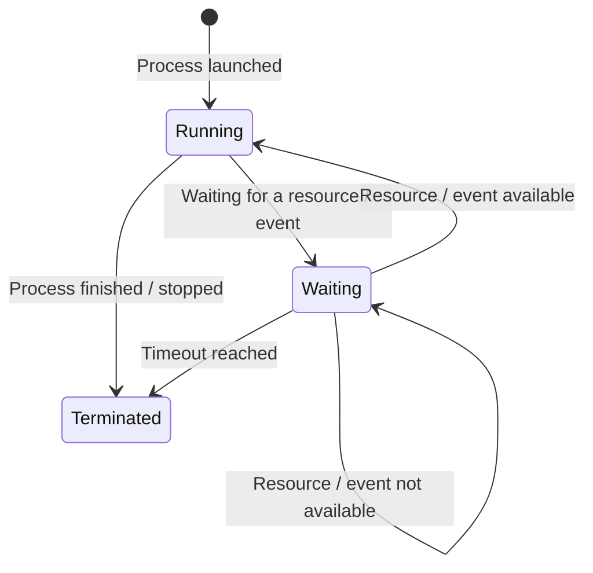

*Realised by: Rahma Rahali*

## What is a process?

A process is simply a program in execution. When you open an application or launch a program, Linux creates a dedicated process for that program.

Each process has:

- **A unique ID (PID):** used by the system to track the process.
- **Its own memory space:** independent from the other processes.
- **A state:** in Linux, a process can transition between various states, each representing its current execution status or the specific resource or event it is awaiting. These states are: Running, Waiting (Blocked) and Terminated.
  - **Running:** the process is actively executing on the CPU.
  - **Waiting (Blocked):** the process is paused, waiting for a specific resource or event.
  - **Terminated:** the process has completed its execution or has been stopped by the system or a user.

The diagram below illustrates the transitions between those different states:

## How are processes created in Linux?

In Linux, process creation relies on two key system calls:

1. **fork():** creates an exact copy of the current process.
2. **exec():** replaces the content of a process with a new program.

## Inter-Process Communication (IPC)

In Linux, processes often need to communicate to share data or synchronize actions. Inter-Process Communication (IPC) provides several mechanisms for this purpose:

- **Pipes:** unidirectional channels for communication between related processes (a main process and its child process).
- **FIFOs:** bidirectional pipes that can be used by unrelated processes.
- **Shared Memory:** allows multiple processes to access the same memory region.
- **Signals:** asynchronous notifications sent between processes to signal events or actions.
- **Message Queues:** enable processes to send and receive messages in a queue.

## Why are processes important?

Processes allow Linux to:

- **Isolate programs:** if one process crashes, it doesn't affect the others.
- **Run multiple programs simultaneously** thanks to task scheduling (the scheduler).

## Useful commands

| Command | Description |
|---------|-------------|
| `ps` | Lists running processes. |
| `top` or `htop` | Shows processes in real time. |
| `kill` | Terminates a running process. |
