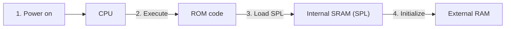
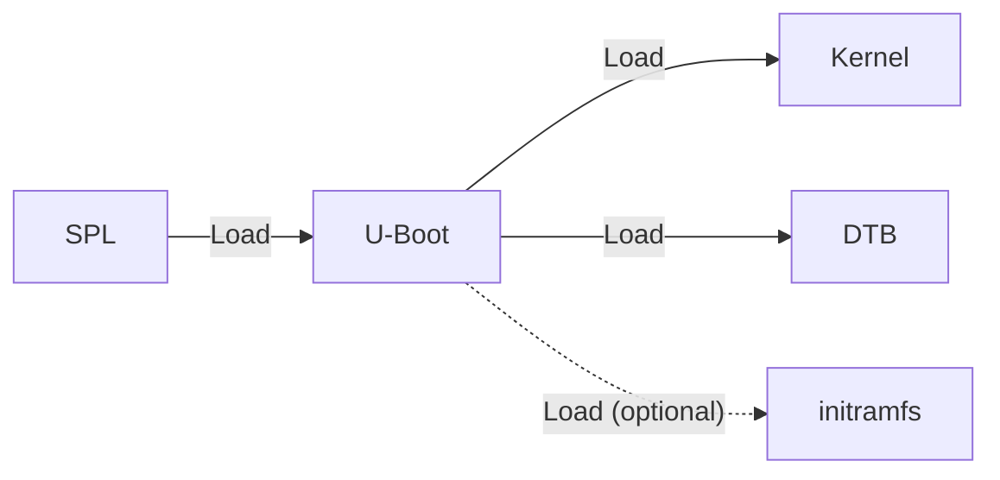
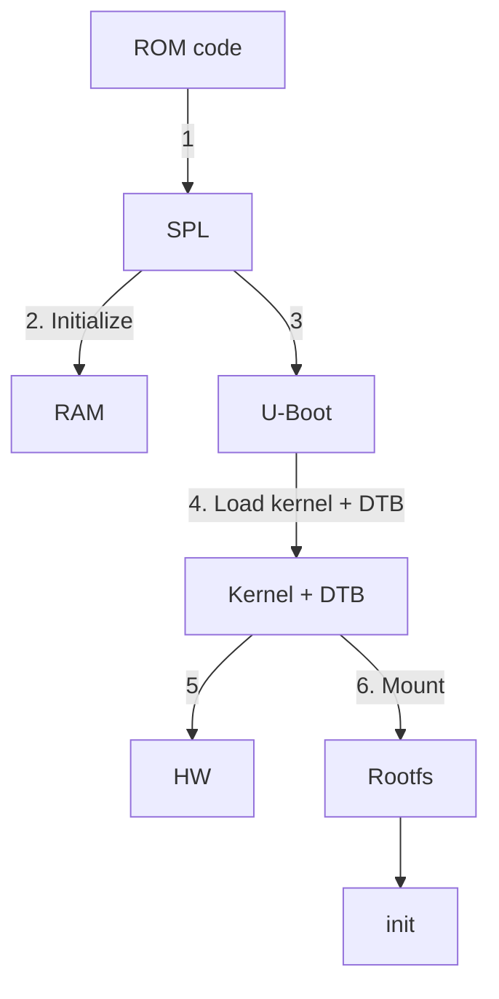

*Rahma Rahali*

## Stage 1: Power-On & ROM Code

To work with our target, the CPU fetches code from RAM and then executes it. But when we first power on our board, how do we reach that point when the RAM is not even initialized yet?

Think about it: to use the RAM, the CPU must configure it properly according to its datasheet (timings, voltages, refresh cycles...). That means some code must run before RAM is ready, to set it up. But here comes the problem: if RAM is not initialized, where does the CPU fetch this first code from, and who writes it?

That's why modern SoCs include a small, built-in memory directly attached to the CPU, often called **internal SRAM**. This is where a very small program can run at startup. The job of this first program is simple but crucial: initialize the external RAM so that the system has working RAM.

This first program is usually called the **SPL** (Secondary Program Loader). It knows exactly how to configure the RAM controller. But we need a way to load this SPL into SRAM. That's where the **ROM Code** comes into play.

The ROM Code is a tiny piece of software, burned into the SoC at manufacturing time by the chip vendor. It cannot be changed. Its job is to look for the SPL in predefined storage devices (like an SD card, eMMC, SPI flash, or USB), load it into the internal SRAM, and then jump to it.

Now we have working RAM. What's next?

## Stage 2: Loading the Bootloader

Once the SPL has initialized the RAM, it can load a bigger program into it: the main bootloader, often called **U-Boot** in the embedded Linux world.

**Why do we need this second stage?** Because the SPL is intentionally tiny. It only has one mission: bring up RAM (and some essential hardware). But once we have working RAM, we can run a much larger program with many more features.

U-Boot provides:

- The ability to load and verify the Linux kernel, device tree, and initramfs.
- Support for multiple filesystems (FAT, EXT...) so it can understand different storage formats to correctly find the kernel.
- Network booting capabilities (TFTP, NFS...) so it can fetch the kernel over the network instead of local storage.
- Environment variables for flexible configuration: U-Boot stores configuration values (like which kernel image to boot, where to find the device tree).

## Stage 3: Booting the Linux Kernel

At this stage, U-Boot has already done its job: it loaded the Linux kernel binary and the Device Tree Blob (DTB) into RAM, and then handed over execution to the kernel. Now the Linux kernel takes full control.

**Why do we need the Device Tree?**

Unlike a PC, an embedded board doesn't have mechanisms to tell the OS what hardware is present. The Device Tree is essentially a hardware description file that tells the kernel:

- Which peripherals are available (I2C, SPI, UART, GPIO, CAN, etc.).
- The memory-mapped addresses of these peripherals.

### What the kernel does after taking control

1. Sets up the CPU scheduling and memory management.
2. Initializes device drivers:
   - Uses the Device Tree to load the right drivers.
   - Brings up buses (I2C, SPI, etc.) and communication peripherals (UART, Ethernet, etc.).
3. Mounts the root filesystem:
   - Finds the filesystem image (from NAND flash, SD card, NFS over Ethernet, etc.).
   - Mounts it as `/`.
   - This gives Linux access to user-space binaries, libraries, and configuration.

## Stage 4: Starting the User Space

The Linux kernel is now awake and running: it has initialized the CPU, the memory, and the hardware drivers. But here's the important thing: the kernel itself doesn't provide a friendly environment for humans or applications.

**What happens in this stage?**

1. The kernel launches the first process (usually `init`).
2. Init starts essential services.
3. A shell or graphical interface starts.
4. User applications can finally run.

## Conclusion

