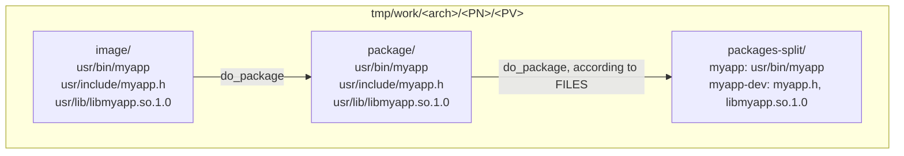
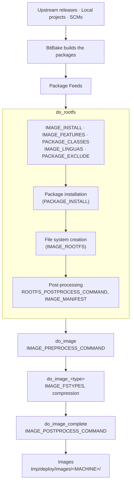

Yocto defines two types of recipes:

- **Package recipes** produce software packages (binaries, libraries, configuration files) ready to be installed on a system.
- **Image recipes** create the final Linux image by selecting which packages to include and organizing the root filesystem, producing a complete bootable system.

Every image is essentially a collection of packages defined by package recipes. Understanding package recipes is the first step to controlling exactly what goes into your image: binaries, libraries, configuration files and system services.

## Package recipes

### Package formats

Yocto supports several package formats:

| Format | Description |
|--------|-------------|
| **RPM** (Red Hat Package Manager) | Originally developed by Red Hat, now widely adopted: Fedora, CentOS, openSUSE. |
| **DEB** (Debian package) | Used in Debian-based distributions such as Ubuntu. |
| **IPK** (Itsy Package Management System) | Designed for embedded devices and inspired by the Debian format. The `opkg` package manager uses it in OpenEmbedded Core, OpenWRT and Poky. |
| **TAR** (Tape Archive) | A widely used tarball format bundling multiple files into one archive. |

Yocto supports these formats through the classes `package_rpm`, `package_deb` and `package_ipk`. You choose one or more formats with the `PACKAGE_CLASSES` variable:

```bitbake
PACKAGE_CLASSES ?= "package_rpm package_deb"
```

### One recipe, several packages

A single recipe can generate multiple package variants. For one recipe we can have:

| Package | Content |
|---------|---------|
| `package` | Main runtime content: executables, configuration files, runtime shared libraries. |
| `package-dev` | Development files needed only to build other applications: header files, static libraries, etc. |
| `package-doc` | Documentation. |
| `package-dbg` | Debug symbols (`*.debug` files), useful for debugging. |

Each recipe exposes the list of packages it produces through the `PACKAGES` variable.

### How does BitBake know where each file belongs?

BitBake uses the `FILES` variables to map installed files to package names. For example:

```bitbake
FILES:${PN}     = "/usr/bin/*"       # package: everything under /usr/bin/
FILES:${PN}-dev = "/usr/include/*"   # package-dev: everything under /usr/include/
```

> You can see how `FILES` is initialized in `bitbake.conf`.
{: .prompt-info }

### From install to packages

After the `do_install` task, all the files installed by the recipe are under `${WORKDIR}/image`. The `do_package` task copies the content of `image/` into `package/`, and BitBake then uses the `FILES` rules to split everything into `packages-split/`.

> At this step Yocto only organizes files into package contents. **No `.deb`, `.rpm` or `.ipk` file exists yet.**
{: .prompt-warning }

The final package files are generated by separate tasks:

| Task | Tool | Output |
|------|------|--------|
| `do_package_write_rpm` | `rpmbuild` | `.rpm` files in `tmp/deploy/rpm/<arch>/` |
| `do_package_write_deb` | `dpkg-deb` | `.deb` files in `tmp/deploy/deb/<arch>/` |
| `do_package_write_ipk` | built-in | `.ipk` files in `tmp/deploy/ipk/<arch>/` |

You can list the tasks that will run for a recipe with:

```bash
bitbake -c listasks <recipe>
```

The following diagram illustrates this workflow:



## Install and removal scripts

Packages can run scripts during installation or removal. These scripts automate tasks such as configuring services, updating links or cleaning up files. There are four types:

**`preinst`** runs before the package is unpacked. Often used to stop running services before an upgrade or installation.

```bitbake
pkg_preinst:${PN}() {
    # your commands here
}
```

**`postinst`** runs after the package is unpacked. Typically used to finalize configuration, create users, set permissions, etc.

```bitbake
pkg_postinst:${PN}() {
    # your commands here
}
```

**`prerm`** runs before a package is removed. Frequently used to stop any daemon or service shipped by the package.

```bitbake
pkg_prerm:${PN}() {
    # your commands here
}
```

**`postrm`** runs after package removal. Used to clean up links, directories or other artifacts.

```bitbake
pkg_postrm:${PN}() {
    # your commands here
}
```

### Where does a postinst script run?

A `postinst` script can be executed in two places:

- **During rootfs generation (build time).** If all dependencies are available, Yocto executes the script while constructing the root filesystem.
- **On the target device (first boot).** If some dependencies are missing at build time, Yocto defers the execution and runs the script on the device.

> Avoid running device-specific commands at build time. Some commands should never run during the build: loading kernel modules, commands requiring hardware access, board-specific initialization.
{: .prompt-warning }

For this case Yocto provides `pkg_postinst_ontarget`, which runs **only on the final device, never during the build**:

```bitbake
pkg_postinst_ontarget:${PN}() {
    # commands executed only on the target device
}
```

You can also use the `$D` variable to know where a script runs. During root filesystem creation, `$D` points to the root directory of the image on the host. On the target system, `$D` is empty. It therefore acts as a context indicator, letting you write scripts that behave differently at build time and after deployment.

```bash
if [ -n "$D" ]; then
    # running at build time, on the host
else
    # running on the target
fi
```

## Image generation

Generating an image in Yocto involves four key steps:

1. Building the root filesystem (rootfs)
2. Installing all required files and packages
3. Wrapping the filesystem into the selected image format
4. Applying compression, if the format supports it

### do_rootfs

The `do_rootfs` task creates the root filesystem of an image. It relies on these variables to decide what gets installed:

| Variable | Role |
|----------|------|
| `IMAGE_INSTALL` | The base list of packages to include in the image. |
| `IMAGE_FEATURES` | Optional features that can pull in additional packages. |
| `PACKAGE_EXCLUDE` | Packages that must be explicitly excluded. |
| `PACKAGE_INSTALL` | The final resolved list of packages passed to the package manager. |

Yocto installs these packages into a temporary directory defined by `IMAGE_ROOTFS`. It is the working directory where Yocto assembles the root filesystem: a staging area, **not** the final image file.

Once the final package list is known, `do_rootfs`:

- invokes the package manager (`dnf`, `apt`, `opkg`, ...) to install packages into the rootfs;
- unpacks and configures each package along with its dependencies;
- executes post-installation scripts during the final stage of installation.

If a post-install script cannot run on the build host, its execution is deferred and the script runs on the target device at first boot.

### do_image

After the rootfs is built, `do_image` turns the rootfs directory into the final image file (`.ext4`, `.tar.gz`, etc.). Before generating the image, Yocto runs any commands listed in `IMAGE_PREPROCESS_COMMAND` (checks, adjustments, ...). It then automatically creates one task per format listed in `IMAGE_FSTYPES`: a task named `do_image_<type>`. For example, if `IMAGE_FSTYPES` contains `ext4`, Yocto creates `do_image_ext4` to generate an EXT4 image.

The final task, `do_image_complete`, completes the image by applying any post-processing specified in `IMAGE_POSTPROCESS_COMMAND`.

The result is located in `tmp/deploy/images/<MACHINE>/`.

The following diagram summarizes this process (simplified from the diagram in the Yocto documentation):



## Example: a package with a systemd service

In this example we create a small package that:

- reads a message from a configuration file and prints it;
- deploys a systemd service to run this application automatically at boot;
- executes a `postinst` script on the target system.

Then we explore how the image is generated and check that the package is installed.

### The application

`hellopkg.c` opens `/etc/hellopkg.conf`, searches for a line starting with `message=` and prints it.

```c
#include <stdio.h>
#include <string.h>

#define CONFIG_FILE "/etc/hellopkg.conf"

int main() {
    FILE *file = fopen(CONFIG_FILE, "r");
    char line[128];

    if (!file) {
        printf("Config file not found: %s\n", CONFIG_FILE);
        return 1;
    }

    while (fgets(line, sizeof(line), file)) {
        if (strncmp(line, "message=", 8) == 0) {
            char *msg = line + 8;     // pointer after "message="

            // remove newline if present
            size_t len = strlen(msg);
            if (len > 0 && msg[len - 1] == '\n') {
                msg[len - 1] = '\0';
            }

            printf("Message from config: %s\n", msg);
            break;
        }
    }

    fclose(file);
    return 0;
}
```

### The service

`hello.service` simply runs the user-space application `hellopkg` as a background service:

```ini
[Unit]
Description=Hello Demo Service

[Service]
Type=simple
ExecStart=/usr/bin/hellopkg

[Install]
WantedBy=multi-user.target
```

### The recipe

`hellopkg_0.1.bb`:

```bitbake
SUMMARY = "recipe for package"
LICENSE = "CLOSED"
SRC_URI = " \
    file://hellopkg.c;subdir=hellopkg \
    file://hello.service;subdir=hellopkg \
"

S = "${WORKDIR}/hellopkg"

inherit systemd

do_compile(){
    ${CC} ${CFLAGS} ${LDFLAGS} hellopkg.c -o hellopkg
}

do_install(){
    install -d ${D}${bindir}
    install -m 0755 hellopkg ${D}${bindir}/hellopkg

    install -d ${D}${sysconfdir}
    echo "message=hello from yocto package" > ${D}${sysconfdir}/hellopkg.conf

    # Install systemd service
    install -d ${D}${systemd_system_unitdir}
    install -m 0644 hello.service ${D}${systemd_system_unitdir}/hello.service
}

FILES:${PN} += "${sysconfdir}/hellopkg.conf"

# Tell Yocto that this package provides a systemd service
SYSTEMD_PACKAGES = "${PN}"
SYSTEMD_SERVICE:${PN} = "hello.service"

pkg_postinst_ontarget:${PN}() {
    echo "hostname=$(hostname)" > /etc/hellopkg-runtime.conf
    echo "postinst executed" | systemd-cat -t hellopkg
}
```

This recipe:

- compiles `hellopkg.c`;
- installs the `hellopkg` binary under `/usr/bin` of the target filesystem;
- creates a configuration file `hellopkg.conf` in `/etc`;
- installs the systemd service unit;
- explicitly includes the configuration file in the package with `FILES:${PN} += "${sysconfdir}/hellopkg.conf"`;
- tells Yocto that the package provides a systemd service (`SYSTEMD_PACKAGES`, `SYSTEMD_SERVICE`), so Yocto **enables the service and starts it at boot**;
- uses `pkg_postinst_ontarget` as an example script: it runs on the target and generates a file containing the hostname.

### Following the packaging process

First run `do_install` and look at the `image/` directory:

```bash
bitbake hellopkg -c do_install
tree tmp/work/core2-64-poky-linux/hellopkg/0.1/image/
```

```text
image/
├── etc
│   └── hellopkg.conf
└── usr
    ├── bin
    │   └── hellopkg
    └── lib
        └── systemd
            └── system
                └── hello.service

6 directories, 3 files
```

All files are in the expected places:

- `etc/` contains the configuration file `hellopkg.conf`;
- `usr/bin/` contains the executable `hellopkg`;
- `usr/lib/systemd/system/` contains the service file `hello.service`.

Now run `do_package`, which copies the files into `package/` and then maps each file to its package under `packages-split/`:

```bash
bitbake hellopkg -c do_package
tree tmp/work/core2-64-poky-linux/hellopkg/0.1/package/
```

```text
package/
├── etc
│   └── hellopkg.conf
└── usr
    ├── bin
    │   └── hellopkg
    ├── lib
    │   └── systemd
    │       ├── system
    │       │   └── hello.service
    │       └── system-preset
    │           └── 98-hellopkg.preset
    └── src
        └── debug
            └── hellopkg
                └── 0.1
                    └── hellopkg.c

11 directories, 5 files
```

> The `98-hellopkg.preset` file was not in our recipe: it is generated by the `systemd` class to enable the service.
{: .prompt-info }

```bash
tree tmp/work/core2-64-poky-linux/hellopkg/0.1/packages-split/
```

```text
packages-split/
├── hellopkg
│   ├── etc
│   │   └── hellopkg.conf
│   └── usr
│       ├── bin
│       │   └── hellopkg
│       └── lib
│           └── systemd
│               ├── system
│               │   └── hello.service
│               └── system-preset
│                   └── 98-hellopkg.preset
├── hellopkg-dbg
│   └── usr
│       └── bin
├── hellopkg-dev
├── hellopkg-doc
├── hellopkg-locale
├── hellopkg.shlibdeps
├── hellopkg-src
│   └── usr
│       └── src
│           └── debug
│               └── hellopkg
│                   └── 0.1
│                       └── hellopkg.c
└── hellopkg-staticdev
```

Each file is now in the right package:

- `hellopkg` contains the binary, its configuration file `hellopkg.conf` and the service file `hello.service`;
- `hellopkg-src` contains the source file `hellopkg.c`.

### Generating the package files

We are ready to generate the packages, but in which format? That is determined by `PACKAGE_CLASSES`:

```bash
bitbake-getvar --value PACKAGE_CLASSES -r hellopkg
```

```text
package_rpm
```

So our package will be generated as RPM. We can confirm it by listing the tasks:

```bash
bitbake -c listtasks hellopkg
```

```text
do_package_qa                Runs QA checks on packaged files
do_package_qa_setscene       Runs QA checks on packaged files (setscene version)
do_package_setscene          Analyzes the content of the holding area and splits it into subsets based ...
do_package_write_rpm         Creates the actual RPM packages and places them in the Package Feed area
do_package_write_rpm_setscene
do_packagedata               Creates package metadata used by the build system to generate the final packages
do_packagedata_setscene
do_patch                     Locates patch files and applies them to the source code
```

Run `do_package_write_rpm`:

```bash
bitbake hellopkg -c do_package_write_rpm
```

Under `tmp/deploy/rpm/<ARCH>` we find:

```text
hellopkg-0.1-r0.core2_64.rpm       hellopkg-dev-0.1-r0.core2_64.rpm
hellopkg-dbg-0.1-r0.core2_64.rpm   hellopkg-src-0.1-r0.core2_64.rpm
```

## Generating the image

First, include the package in the image. Because we use systemd and `systemctl`, we also add these lines to `local.conf`:

```bitbake
IMAGE_INSTALL:append = " hellopkg"

DISTRO_FEATURES:append = " systemd"
DISTRO_FEATURES:append = " usrmerge"
VIRTUAL-RUNTIME_init_manager = "systemd"
VIRTUAL-RUNTIME_initscripts = "systemd-compat-units"
IMAGE_INSTALL:append = " systemd"
```

Before building, we can check the variables that will be used: `IMAGE_INSTALL`, `IMAGE_FEATURES`, `PACKAGE_INSTALL`, `PACKAGE_EXCLUDE`. For example `PACKAGE_INSTALL`:

```bash
bitbake-getvar PACKAGE_INSTALL -r core-image-minimal
```

```text
export PACKAGE_INSTALL="packagegroup-core-boot hello-app hellopkg systemd run-postinsts "
```

Our `hellopkg` is part of the final set of packages to install.

Start with the `do_rootfs` task:

```bash
bitbake core-image-minimal -c do_rootfs
```

Then examine the rootfs directory to make sure the whole root filesystem was created correctly. Before generating the image, check its type with `IMAGE_FSTYPES`:

```bash
bitbake-getvar IMAGE_FSTYPES -r core-image-minimal
```

```text
IMAGE_FSTYPES=" tar.bz2 ext4"
```

Yocto will therefore produce two images:

- a `tar.bz2` archive of the root filesystem;
- an `ext4` image, ready to be mounted or used with QEMU.

The final result is in `tmp/deploy/images/<ARCH>/`:

```text
core-image-minimal-qemux86-64.rootfs.ext4
core-image-minimal-qemux86-64.rootfs.manifest
core-image-minimal-qemux86-64.rootfs.qemuboot.conf
core-image-minimal-qemux86-64.rootfs.spdx.tar.zst
core-image-minimal-qemux86-64.rootfs.tar.bz2
core-image-minimal-qemux86-64.rootfs.testdata.json
```

## Testing in QEMU

Check the service status:

```text
root@qemux86-64:~# systemctl status hello.service
● hello.service - Hello Demo Service
     Loaded: loaded (/usr/lib/systemd/system/hello.service; enabled; preset: enabled)
     Active: inactive (dead) since Wed 2025-12-17 11:47:25 UTC; 20s ago
   Duration: 418ms
    Process: 311 ExecStart=/usr/bin/hellopkg (code=exited, status=0/SUCCESS)
   Main PID: 311 (code=exited, status=0/SUCCESS)
        CPU: 233ms
```

```text
root@qemux86-64:~# journalctl -u hello.service
Dec 17 11:47:25 qemux86-64 systemd[1]: Started Hello Demo Service.
Dec 17 11:47:25 qemux86-64 hellopkg[311]: Message from config: hello from yocto package
Dec 17 11:47:25 qemux86-64 systemd[1]: hello.service: Deactivated successfully.
```

```text
root@qemux86-64:~# cat /etc/hellopkg.conf
message=hello from yocto package
```

This confirms that the service is enabled and starts the `hellopkg` application, which reads and prints the message from `/etc/hellopkg.conf`. The service is `inactive (dead)` simply because the program prints its message and exits.

The `postinst` script also ran on the target: `/etc/hellopkg-runtime.conf` was created and contains the hostname.

```text
root@qemux86-64:~# cat /etc/hellopkg-runtime.conf
hostname=qemux86-64
```
