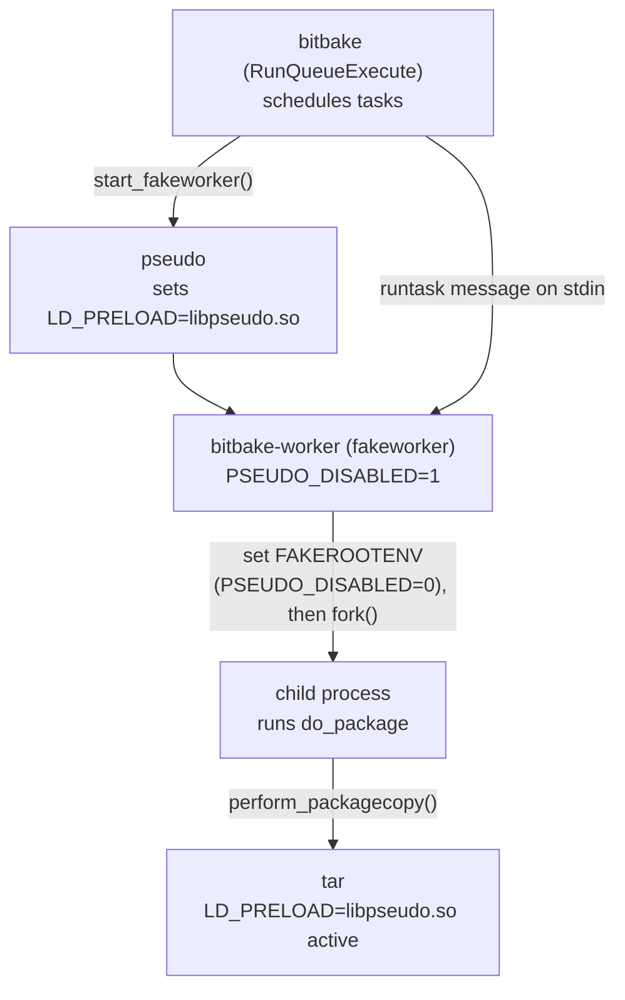
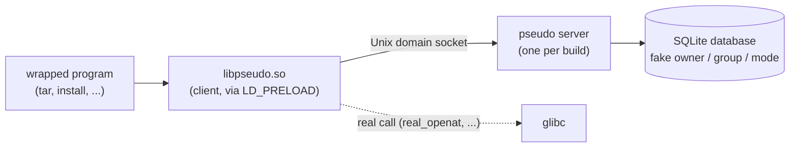

## The problem fakeroot solves

Building a Linux image means creating tens of thousands of files. Many of them must, in the final system, belong to `root`, carry special permissions (setuid), or represent special device nodes (`/dev/null`, `/dev/sda`, ...). But the person running `bitbake` is **not** root on their machine. Giving a build tool real root privileges would be a massive security hole, and would make building on a shared machine or in CI completely irresponsible.

**fakeroot** is the general concept, and its implementation in Yocto is called **pseudo**. It resolves this contradiction: it lets a program believe it has root privileges, without those privileges ever being real on disk. The file remains, in truth, owned by the normal user who launched the build, but the tool keeps track of the "real" intended attributes (owner, permissions) to apply them later, when the final image is assembled.

## The interception mechanism: LD_PRELOAD

To maintain this illusion, pseudo needs to know about every operation a program performs on files (opening, creating, changing ownership, ...). It cannot guess, so it has to **intercept**.

The technique is `LD_PRELOAD`, a standard Linux environment variable. When it is set, the system's dynamic loader gives priority to the functions defined in the library it names over those in the standard library (glibc). pseudo ships its own library, `libpseudo.so`, which redefines a large set of classic functions (`open`, `openat`, `chown`, `mkdir`, ...) under the exact same names as their glibc counterparts.

Concretely, when a program calls `openat(...)`, glibc's function no longer answers first: pseudo's does. It does the real work (internally calling the real glibc function under a reserved name, `real_openat`) and, in addition, records in an internal table: "this file descriptor maps to this path." That table is what later lets pseudo keep its permission illusion consistent.

## Where fakeroot comes into play in a recipe

Not every task needs pseudo, only the ones that manipulate files whose ownership and permissions matter for the final image (typically `do_install` and `do_package`). This list is declared explicitly in Yocto's classes:

```python
# meta/classes-global/base.bbclass

d.appendVarFlag('do_package', 'depends', ' virtual/fakeroot-native:do_populate_sysroot')

d.setVarFlag('do_package', 'fakeroot', '1')
```

`setVarFlag(..., 'fakeroot', '1')` sets a simple flag on the task. That flag is what BitBake consults when deciding how to execute the task.

## The real execution mechanism

### 0. The FAKEROOTCMD, FAKEROOTENV and FAKEROOTBASEENV variables

Before tracing the mechanism, here are the variables used later in the code. They are defined in `bitbake.conf`:

```bitbake
# meta/conf/bitbake.conf

FAKEROOTBASEENV = "PSEUDO_BINDIR=${PSEUDO_SYSROOT}${bindir_native} \
                   PSEUDO_LIBDIR=${PSEUDO_SYSROOT}${prefix_native}/lib/pseudo/lib \
                   PSEUDO_PREFIX=${PSEUDO_SYSROOT}${prefix_native} \
                   PSEUDO_IGNORE_PATHS=... PSEUDO_DISABLED=1 PYTHONDONTWRITEBYTECODE=1"

FAKEROOTCMD = "${PSEUDO_SYSROOT}${bindir_native}/pseudo"

FAKEROOTENV = "PSEUDO_PREFIX=${PSEUDO_SYSROOT}${prefix_native} \
               PSEUDO_LOCALSTATEDIR=${PSEUDO_LOCALSTATEDIR} \
               PSEUDO_PASSWD=${PSEUDO_PASSWD} PSEUDO_NOSYMLINKEXP=1 \
               PSEUDO_IGNORE_PATHS=... PSEUDO_DISABLED=0"
```

| Variable | Role |
|----------|------|
| `FAKEROOTCMD` | The `pseudo` binary itself. |
| `FAKEROOTBASEENV` | Environment of the permanent worker, with `PSEUDO_DISABLED=1` (pseudo present but **inactive**). |
| `FAKEROOTENV` | Environment applied to a fakeroot task, with `PSEUDO_DISABLED=0` (pseudo **active**). |

### 1. The main process starts

The process started by `bitbake <recipe>` contains the scheduling logic (`RunQueueExecute`, in `runqueue.py`). It knows which tasks to run, in what order, and which ones are flagged `fakeroot`. But it never runs a task's code itself. Instead it maintains two worker processes: a plain **worker**, and a **fakeworker** for tasks that need pseudo.

```python
# bitbake/lib/bb/runqueue.py, RunQueueExecute.execute()

if 'fakeroot' in taskdep and taskname in taskdep['fakeroot'] and not self.cooker.configuration.dry_run:
    if not mc in self.rq.fakeworker:
        self.rq.start_fakeworker(self, mc)
    RunQueue.send_pickled_data(self.rq.fakeworker[mc].process, runtask, "runtask")
    self.rq.fakeworker[mc].process.stdin.flush()
else:
    RunQueue.send_pickled_data(self.rq.worker[mc].process, runtask, "runtask")
    self.rq.worker[mc].process.stdin.flush()
```

For a task flagged `fakeroot`, this checks whether a fakeworker already exists for the current build configuration (`mc`). If not, it creates one with `start_fakeworker()`. Either way, the task is not launched as a new process: it is serialized (`send_pickled_data`) and sent as a message over the worker's **stdin pipe**. The same persistent worker then handles many further fakeroot tasks throughout the build, one message at a time, without restarting.

### 2. Creating the fakeworker

```python
def start_fakeworker(self, rqexec, mc):
    if not mc in self.fakeworker:
        self.fakeworker[mc] = self._start_worker(mc, True, rqexec)

def _start_worker(self, mc, fakeroot = False, rqexec = None):
    ...
    workerscript = os.path.realpath(os.path.dirname(__file__) + "/../../bin/bitbake-worker")
    if fakeroot:
        mcdata = self.cooker.databuilder.mcdata[mc]
        fakerootcmd = shlex.split(mcdata.getVar("FAKEROOTCMD"))
        fakerootenv = (mcdata.getVar("FAKEROOTBASEENV") or "").split()
        env = os.environ.copy()
        for key, value in (var.split('=',1) for var in fakerootenv):
            env[key] = value
    ...
    worker = subprocess.Popen(fakerootcmd + [sys.executable, workerscript, magic],
                              stdout=subprocess.PIPE, stdin=subprocess.PIPE, env=env)
```

`FAKEROOTCMD` resolves to the real `pseudo` binary, so the command actually launched is, in essence, `pseudo python3 bitbake-worker`. pseudo is the very first process started and becomes the **parent** of the worker.

Its starting environment, though, is built from `FAKEROOTBASEENV`, the variant with `PSEUDO_DISABLED=1`. In other words, this permanent worker is born with pseudo present (it is literally its parent process) but **inactive**.

`bitbake-worker` itself does not know in advance which tasks it will run. It is a generic program that waits for instructions arriving over its input pipe and processes them one after another for as long as the build lasts. That is what makes reusing a single long-lived worker, rather than spawning one process per task, both possible and efficient.

### 3. Enabling pseudo and preparing the environment

When the worker receives a message asking it to run a task flagged `fakeroot`, it does not execute the task's code inside itself. It duplicates itself with `fork()`, and the new process runs the task. But just before forking, it **turns pseudo on** and refreshes the environment.

```python
# bitbake/bin/bitbake-worker, fork_off_task(), ~L157-166

# We need to setup the environment BEFORE the fork, since
# a fork() or exec*() activates PSEUDO...

if 'fakeroot' in taskdep and taskname in taskdep['fakeroot'] and not dry_run:
    fakeroot = True
    envvars = (runtask['fakerootenv'] or "").split()
    for key, value in (var.split('=',1) for var in envvars):
        envbackup[key] = os.environ.get(key)
        os.environ[key] = value
        fakeenv[key] = value
    ...
pid = os.fork()
```

This time `runtask['fakerootenv']` carries the other variable, `FAKEROOTENV`, the one with `PSEUDO_DISABLED=0`. Task by task, the worker toggles pseudo from off to on in its own environment (`os.environ[key] = value`) immediately before each `fork()`, never altering the permanent worker's baseline state for longer than a single task.

`runtask['fakerootenv']` is itself the value of the Yocto variable `FAKEROOTENV`, read once by `bb/cache.py` when the recipe is loaded and carried inside the `runtask` message sent by `execute()`.

### 4. Why the order (enable, then fork) matters

In Unix, a child created by `fork()` automatically inherits its parent's environment exactly as it stands at the moment of the fork. If the worker had modified `PSEUDO_DISABLED` **after** forking, only the process that made the change would benefit from it, not the one that actually has to run the task. By flipping it on right before `fork()`, the worker guarantees that the future child process starts out already in a consistent, pseudo-enabled environment.

### 5. What pseudo does with that inheritance

pseudo, as the parent of the worker (and therefore the grandparent of the process that ultimately runs `do_package`), has already prepared its own `LD_PRELOAD` variable at startup, inside its internal function `pseudo_setupenv()`:

```c
/* pseudo_util.c, function pseudo_setupenv() */

char *ld_preload = GETENV(PRELINK_LIBRARIES); /* == "LD_PRELOAD" */
ld_preload = with_libpseudo(ld_preload, libdir_path);
SETENV(PRELINK_LIBRARIES, ld_preload, 1);
```

Once set inside the pseudo process, this variable propagates automatically to every descendant: the worker, then the process created by `fork()`, then finally `tar`, launched from that last process via `perform_packagecopy()` (`package.bbclass`, around line 344). This cascading inheritance across several generations of processes is what leaves `tar` running with `LD_PRELOAD=libpseudo.so` active, without ever having been configured for it explicitly.



## How fakeroot grants "root" ownership to files

Everything so far explains how pseudo routes a program's file operations through its own code. It does not yet show how pseudo makes a file *appear* to belong to root.

### Reading and writing ownership are two different problems

A wrapped program interacts with file ownership in two ways:

- it can **ask** for a file's current owner (the `stat` family of calls);
- it can **request a change** of owner (the `chown` family of calls).

pseudo has to intercept both: one to report the simulated ownership consistently, the other to establish what that simulated ownership should be. The write side is the simpler one to start with.

### The chown wrapper

pseudo's wrapper for `fchownat` (through which `chown`, `lchown` and `fchown` all route) makes its intent explicit in a source comment:

```c
/* ports/unix/guts/fchownat.c */

PSEUDO_STATBUF buf;
...
rc = base_fstatat(dirfd, path, &buf, flags);
if (rc == -1) {
    return rc;
}
...
if (owner != (uid_t) -1) {
    buf.st_uid = owner;
}
if (group != (gid_t) -1) {
    buf.st_gid = group;
}
pseudo_client_op(OP_CHOWN, 0, -1, dirfd, path, &buf);
/* just pretend we worked */
errno = save_errno;
rc = 0;
```

There is **no real system call to change ownership** anywhere in this code path (no `real_fchownat(...)`, for example). Instead, the wrapper:

1. reads the file's actual current attributes from disk (`base_fstatat`);
2. overwrites the owner and group fields in an in-memory structure with what the caller asked for;
3. hands that structure to `pseudo_client_op(OP_CHOWN, ...)`;
4. reports success (`rc = 0`) to the caller, without the real filesystem ever being touched.

On disk, the file still belongs to whichever unprivileged user actually ran the build. Only pseudo's own bookkeeping "knows" it is supposed to look like it belongs to root.

### A client/server architecture

`pseudo_client_op()` is the function every wrapper ultimately calls to report an intercepted operation to pseudo. It routes that report into a proper client/server system, not just an in-memory table local to each process:

```c
/* pseudo_client.c */

static int connect_fd = -1;
...
connect_fd = socket(PF_UNIX, SOCK_STREAM, 0);
...
rc = pseudo_msg_send(connect_fd, msg, len, path);
```

The code compiled into `libpseudo.so` (running inside whatever program is being wrapped) is only the **client** side. It serializes each operation into a message and sends it over a **Unix domain socket** to a separate, long-running **server** process (`pseudo_server.c`), started once per build and shared by every wrapped program. That server actually owns and updates the state, which is why pseudo's illusion of ownership stays consistent not just within a single invocation, but across every program and every task for the whole build.

The server persists its state in a real **SQLite database** (`pseudo_db.c` links against `sqlite3` and issues genuine `CREATE TABLE` statements), consistent with the pseudo recipe's own `DEPENDS = "sqlite3 attr"`. Every "fake" owner, group and permission mode a task has ever set lives in that database for the lifetime of the build. It is read back by the `stat` wrappers when a program asks "who owns this file?", and later when Yocto assembles the final image and needs to know what ownership each file should actually carry.



## Summary

- **Why:** the build user is not root, but the image needs root-owned files, setuid bits and device nodes.
- **How it intercepts:** `LD_PRELOAD=libpseudo.so` redefines file-related glibc functions.
- **Which tasks:** those flagged `fakeroot` (typically `do_install`, `do_package`), run by a dedicated *fakeworker* started under `pseudo`.
- **How it stays consistent:** `PSEUDO_DISABLED` is flipped to `0` right before `fork()`, so the child inherits an active pseudo.
- **How it fakes ownership:** `chown` is never really executed; the intended attributes are sent to a pseudo server that stores them in SQLite and replays them when the image is assembled.
