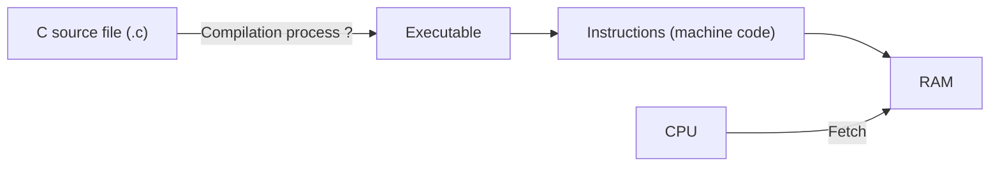
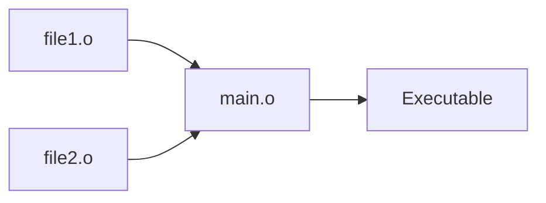
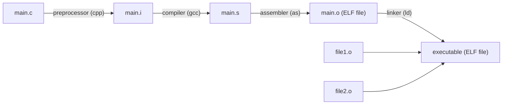

When you write a C program, you typically save it in a `.c` file. But how does it transform into a binary that your CPU can execute?



The compilation process consists of 4 stages: **preprocessing**, **compilation**, **assembly** and **linking**.

## Preprocessing

The preprocessor's job is to prepare the source code before the compiler even sees it. It:

- Inserts the content of header files (`#include`).
- Replaces macros (`#define`).
- Removes comments.
- Handles conditional compilation (`#if`, `#ifdef`).

Without preprocessing, every `.c` file would need to manually contain all the declarations it uses. Libraries like `stdio.h` would have to be rewritten in every file, and macros would not work.

`main.c` → `main.i`

Now `main.i` contains C code with no preprocessor directives.

## Compilation

The CPU doesn't understand C. It understands only machine code, but before generating that, we go through **assembly**, a human-readable intermediate step that makes debugging and optimization easier. This is where the compiler takes action: it translates the C code into assembly language for your CPU architecture (x86, ARM, etc.).

`main.i` → `main.s`

Now `main.s` contains assembly instructions like `movl $0, %eax`.

## Assembly

This step is an intermediate stage; it makes our code ready to be linked with other necessary files. In this stage, the assembler analyzes the assembly file and turns it into an **object file** (`.o`).

This file contains:

- **Machine instructions** your CPU understands.
- **Symbol table**: a list of all the functions and variables, with their names and where to find them.
- **Relocation info**: notes telling the linker, "This function or variable is used here, but I don't yet know its final address. You'll need to fill it in later."

`main.s` → `main.o`

## Linking

In most cases, we include several libraries and files in our code. At this stage, each object file is isolated (calling `printf` in `main.c` would fail because it lives in the C standard library, libc). This is where we need the **linker**, which combines multiple object files and libraries into a **single executable**.



## Executable format

The executable is a binary that contains instructions and data (global, constant, local...). We have to use a common and structured format that contains all this information. This format is called **ELF**: **Executable and Linkable Format**.

An ELF file is divided into multiple **sections**, each serving a specific role in organizing the program's data and code. Here are the most important ones:

| Section   | Content |
|-----------|---------|
| `.text`   | The **executable machine code**: the actual instructions the CPU runs. |
| `.data`   | **Initialized global and static variables**. |
| `.bss`    | **Uninitialized global and static variables**. |
| `.rodata` | Read-only data like constants. |

Each section organizes parts of your program to help the linker combine multiple object files properly, and then to help the loader place code and data correctly in memory. It also serves debugging and runtime memory usage.

The main ELF file types are:

- **Relocatable files (ET_REL)**: these are object files (`.o`) produced by the assembler. They contain machine code but are not yet complete programs because addresses are not fixed. They have to be combined (linked) with other object files to create executables or libraries.
- **Executable files (ET_EXEC)**: these are fully linked and runnable programs.

## The whole process at a glance



## Compilation process with commands

1. **Preprocessing**:

   ```bash
   gcc -E main.c -o main.i
   ```

2. **Compilation**:

   ```bash
   gcc -S main.i -o main.s
   ```

3. **Assembly**:

   ```bash
   gcc -c main.s -o main.o
   ```

4. **Linking**:

   ```bash
   gcc file1.c file2.c main.o -o main
   ```
