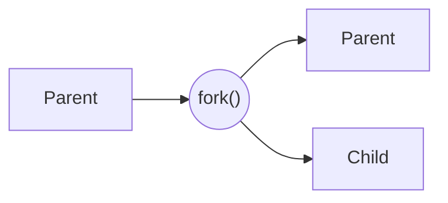
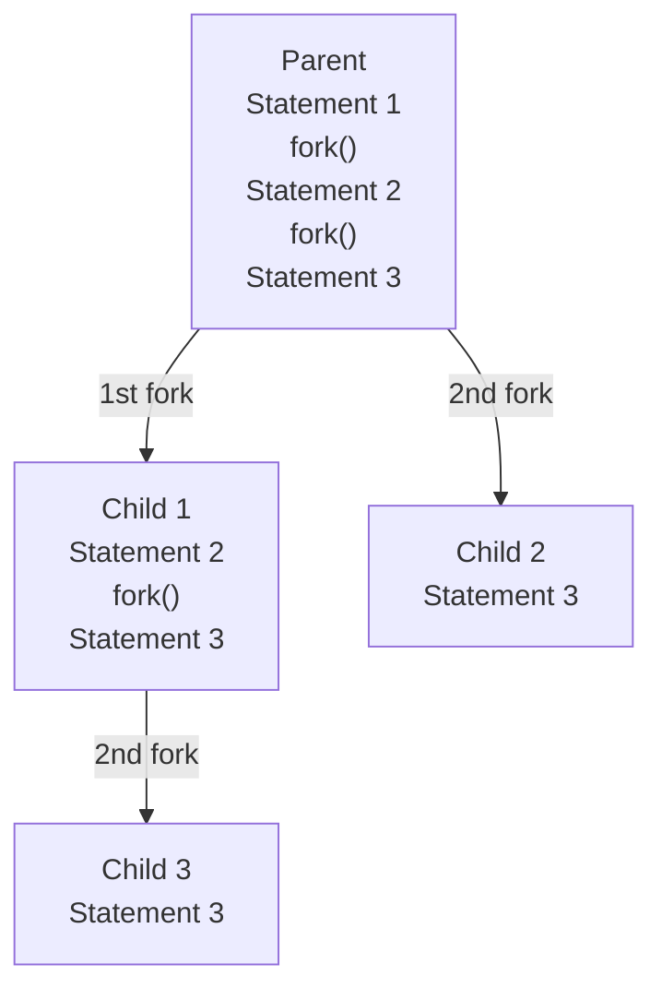
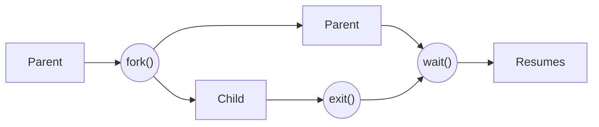

*Realised by: Rahma Rahali*

## Introduction

In Linux, the `fork()` function creates a new process (child process) that is an exact duplicate of the calling process (parent process). After `fork()` is called, both the parent and child processes run concurrently, executing the same instructions that follow the `fork()` call.



## How does fork() work?

When a process calls `fork()`, Linux creates a new process by duplicating the calling one (the parent). The new process, known as the child process, receives a unique process ID (PID) but shares the same code, memory layout, and file descriptors as the parent.

```text
Parent process (PID = X)          Child process (PID = Y)
┌──────────────────────┐          ┌──────────────────────┐
│ Code_1();            │          │ Code_1();            │
│ fork(); ─────────────┼────────► │ fork();              │
│ Code_2();            │          │ Code_2();  ◄── the child begins execution here
└──────────────────────┘          └──────────────────────┘
```

### What does fork() return?

- In the parent process, it returns the child process ID.
- In the child process, it returns `0`.
- In case of failure, it returns `-1` (e.g., insufficient system resources).

The value returned by `fork()` helps us determine whether we are in the parent process or the child process.

#### Example 1

```c
#include <unistd.h>
#include <stdio.h>

int main()
{
    int id = fork();
    if (id == 0)
    {
        printf("Hello from the child process, ID = %d \n", id);
    }
    else
    {
        printf("Hello from the main process, ID = %d \n", id);
    }

    return 0;
}
```

Output:

```text
Hello from the main process, ID = 88964
Hello from the child process, ID = 0
```

#### Example 2

```c
#include <unistd.h>
#include <stdio.h>

int main()
{
    int id = fork();
    printf("current ID : %d, parent ID : %d \n", getpid(), getppid());
    return 0;
}
```

Output:

```text
current ID : 87991, parent ID : 84029
current ID : 87992, parent ID : 87991
```

In the example above we used two functions, `getpid()` and `getppid()`:

- **getpid()**: returns the PID of the process.
- **getppid()**: returns the PID of the parent process.

## Calling fork() multiple times

When calling `fork()` multiple times, each `fork()` duplicates the process that calls it.

Supposing that we call `fork()` two times:

```text
Parent process:

Statement 1
fork();
Statement 2
fork();
Statement 3
```

- The 1st `fork()` is executed only by the parent: Parent ==> Child1
- The 2nd `fork()` is executed by the parent and Child1: Parent ==> Child2, Child1 ==> Child3



In total, we have **4 processes**.

#### Example 3

```c
#include <stdio.h>
#include <unistd.h>

int main() {
    fork();
    fork();
    printf("Process ID: %d\n", getpid());
    return 0;
}
```

Output:

```text
Process ID: 243923
Process ID: 243925
Process ID: 243924
Process ID: 243926
```

### General rule

If you call `fork()` **n** times, the total number of processes will be **2^n**. This exponential growth can be used for parallel computing, but it must be managed carefully to avoid system resource exhaustion.

## The wait() function

When creating processes using `fork()`, we have to manage the execution of these processes to prevent the occurrence of **zombie processes**. A zombie process is a child process that has finished executing but whose parent has not yet collected its exit status. So we have to make sure that the parent process waits for its child process to finish execution. In this context, the **wait()** function stops the execution of the parent until a child has finished executing.



The `wait()` function returns:

- `-1` if there are no child processes to wait for.
- The process ID of the child process we are waiting for.

When using `wait()`, the parent process waits until one of the children finishes executing. So, if the parent has two children, c1 and c2, and c1 finishes while c2 doesn't, the parent will be resumed. To avoid this, we need to check that there are no children left to wait for by verifying the return value of `wait()`.

#### Example 4

```c
#include <stdio.h>
#include <unistd.h>
#include <sys/wait.h>

int main() {
    pid_t pid = fork();

    if (pid > 0) {
        // Parent process
        wait(NULL);  // Wait for the child process to terminate
        printf("Parent: Child process has finished.\n");
    } else if (pid == 0) {
        // Child process
        printf("Child: Running and now exiting.\n");
    } else {
        // Fork failed
        perror("fork failed");
        return 1;
    }

    return 0;
}
```

Output:

```text
Child: Running and now exiting.
Parent: Child process has finished.
```
