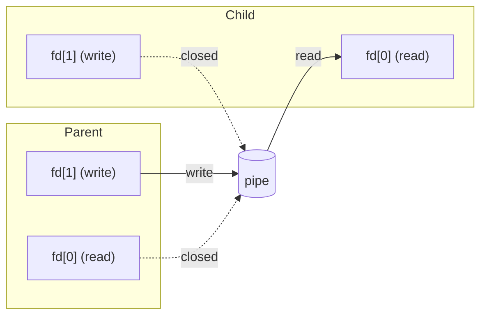

*Realised by: Rahma Rahali*

## Introduction

**A pipe** in Unix is a communication mechanism that allows the output of one process to be used as an input for another process. It enables transferring data between processes in a **unidirectional** manner.

There are two types of pipes:

- **Unnamed pipes**: used for communication between related processes (e.g., a parent and a child process). They are typically created using system calls like `pipe()`.
- **Named pipes (FIFOs)**: pipes with a name that can be used by unrelated processes. They are created using the `mkfifo()` system call. (This type will be explored in an upcoming article.)

## How pipes work

When an unnamed pipe is created using the `pipe()` system call, the kernel allocates a buffer in memory to hold the data that will be transferred between processes. This buffer typically has a fixed size depending on the system.

The `pipe()` function returns two file descriptors: one for reading from the pipe and the other for writing to it. These file descriptors are stored in an array passed as an argument to `pipe()`.

The write end of the pipe is used by the writing process to send data, while the read end is used by the reading process to retrieve data.

Data written to the pipe is stored in the buffer temporarily. If the buffer is full, the writing process is blocked until there is space available. Similarly, if the buffer is empty and the reading process attempts to read from the pipe, it is blocked until data is written.

Once the processes are done with the pipe, they close the file descriptors, and the buffer is deallocated.

### How to use the pipe() system call

```c
int pipe(int pipefd[2]);
```

- `pipefd[0]` ==> read file descriptor (read end of the pipe)
- `pipefd[1]` ==> write file descriptor (write end of the pipe)

## Using pipes for Inter-Process Communication

Pipes enable a unidirectional flow of data from one process to another, typically from a parent process to its child, or vice versa.

After the creation of the pipe, we call `fork()`, so the file descriptors are copied over. If we close a file descriptor in one process, it remains open in the other process, since they are independent. So for this communication to work properly, each process must close the ends of the pipe it doesn't use. This prevents deadlocks and ensures that the pipe behaves as expected.



Reading from and writing to a pipe is done using the standard `read()` and `write()` system calls. When data is written to the pipe, it is stored in a kernel buffer. The reading process retrieves this data from the buffer. If the buffer becomes full, the writing process is blocked until space becomes available. Likewise, if the buffer is empty, the reading process blocks until there is data to read, unless the write end has been closed, in which case `read()` returns 0 (end-of-file).

#### Example 1: Parent writing to the pipe, child reading

```c
#include <stdio.h>
#include <unistd.h>
#include <sys/wait.h>

int main() {
    int fd[2]; // fd[0] - read end, fd[1] - write end
    pid_t pid;
    char buffer[100];

    if (pipe(fd) == -1) {
        perror("An error occurred when opening the pipe \n");
        return 1;
    }

    pid = fork();
    if (pid < 0) {
        perror("An error occurred with fork() \n");
        return 1;
    }

    if (pid > 0) {
        // Parent process
        int x;
        close(fd[0]); // Close unused read end
        printf("Input a number : ");
        scanf("%d", &x);
        if (write(fd[1], &x, sizeof(int)) == -1)
        {
            printf("An error occurred when writing in the pipe \n");
            return 1;
        }
        close(fd[1]); // Close write end after writing
        wait(NULL);   // Wait for child to finish
    } else {
        // Child process
        int y;
        close(fd[1]); // Close unused write end
        if (read(fd[0], &y, sizeof(int)) == -1)
        {
            printf("An error occurred when reading from the pipe \n");
            return 1;
        }
        printf("Child received: %d\n", y);
        close(fd[0]); // Close read end after reading
    }

    return 0;
}
```

Output:

```text
Input a number : 5
Child received: 5
```
