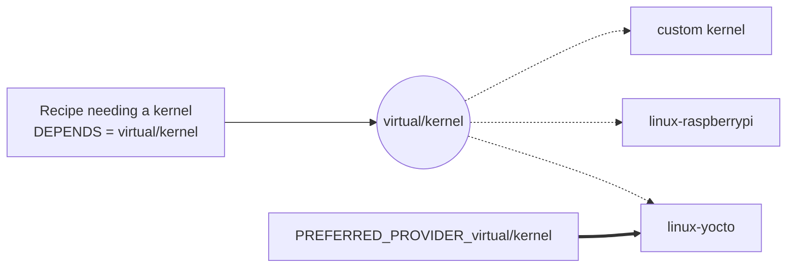

## Metadata

Metadata is simply information stored in structured text files. BitBake uses three types of metadata:

- **Configuration** (`.conf` files)
- **Classes** (`.bbclass` files)
- **Recipes** (`.bb` and `.bbappend` files)

### Configuration files (.conf)

These files contain variables that customize the build process (machine settings, distro, etc.). The main ones are:

| File | Location | Purpose |
|------|----------|---------|
| `local.conf` | `conf/` in the build directory | User-defined variables that customize the build: target machine, distribution, packages to install in the image, etc. |
| `bitbake.conf` | `meta/conf/` | Core variables such as `PN` (package name), `PV` (package version), `WORKDIR` (working directory), `TCLIBC` (target C library), and the C compiler commands and options (`CC`, `CFLAGS`, ...). |
| `bblayers.conf` | `conf/` in the build directory | Lists the layers included in the build. |
| `<distro>.conf` | `meta-yourlayer/conf/distro/` | Configuration of a custom distribution. |
| `<machine>.conf` | `meta-yourlayer/conf/machine/` | Configuration of a particular hardware target. |

### Class files (.bbclass)

A class is a mechanism to share common functionality between recipes. To use a class, the recipe must `inherit` it.

Every recipe implicitly inherits `base.bbclass`, which implements the basic tasks (`do_fetch`, `do_unpack`, `do_configure`, etc.).

### Recipes (.bb and .bbappend)

A recipe tells BitBake how to build a package for your image. It contains instructions such as where to fetch the source code, how to compile it, and how to install it into the target filesystem.

- **`.bb`**: the main recipe file. It defines everything needed to fetch, configure, compile and package a software component.
- **`.bbappend`**: an append file used to modify or extend an existing recipe without changing the original `.bb` file.

## Dependencies

BitBake defines three types of dependency:

- **Build-time dependency**, expressed with `DEPENDS`.
- **Execution-time (runtime) dependency**, expressed with `RDEPENDS`.
- **Task dependency**: the execution order of tasks. In the end, every dependency is a task dependency.

According to the recipes' dependencies, BitBake organizes tasks as follows:

- recipe tasks with no dependency relation are built **in parallel**;
- dependent recipes are built **in serial order**.

### Example: hello-app and hello-lib

Consider a source file `hello-app.c` that calls a function defined in another file, `hello-lib.c`.

`hello-app.c`:

```c
extern void print_hello();

int main() {
    print_hello();
    return 0;
}
```

`hello-lib.c`:

```c
#include <stdio.h>

void print_hello() {
    printf("Hello from lib!\n");
}
```

Here `hello-app` depends on `hello-lib` to be compiled and to run correctly.


- At compile time, the compiler needs access to the symbols provided by `hello-lib` (the shared object file). So the `hello-app` recipe declares a **compile-time dependency** with `DEPENDS`.
- At execution time, the `hello-app` binary dynamically links to the shared object. To guarantee that the library is in the final image, we declare a **runtime dependency** with `RDEPENDS:${PN}`.

The main steps are:

1. Create a recipe for `hello-lib` that builds and installs a shared library into the image.
2. Create a recipe for `hello-app`, defining `DEPENDS` and `RDEPENDS`.
3. Build the `hello-lib` recipe.
4. Build the `hello-app` recipe.

### The hello-lib recipe

`hello-lib_0.1.bb`:

```bitbake
SUMMARY = "recipe for creating the shared library"
LICENSE = "CLOSED"
SRC_URI = " \
    file://hello-lib.c;subdir=helloapp \
"

S = "${WORKDIR}/helloapp"

LDFLAGS += "-Wl,-soname,libhello.so.1"

do_compile(){
    ${CC} ${CFLAGS} ${LDFLAGS} -fPIC -c hello-lib.c -o hello-lib.o
    ${CC} ${CFLAGS} ${LDFLAGS} -shared -o libhello.so.1.0 hello-lib.o
}

do_install(){
    install -d ${D}${libdir}

    install -m 0755 libhello.so.1.0 ${D}${libdir}/

    ln -sf libhello.so.1.0 ${D}${libdir}/libhello.so.1
    ln -sf libhello.so.1   ${D}${libdir}/libhello.so
}
```

This recipe builds and installs a shared library named `libhello.so`:

- It first compiles `hello-lib.c` into a position-independent object file (`hello-lib.o`) with `-fPIC`. This is required for shared libraries, since the code can then be loaded at any memory address.
- It then links the object into a shared object (`libhello.so.1.0`) with `-shared`.
- `LDFLAGS` includes `-Wl,-soname,libhello.so.1`, which sets the **SONAME** of the library. The SONAME tells the dynamic linker which version of the library to use when an application links against it.
- Finally, `do_install()` installs the library into `${libdir}` and creates two symbolic links: `libhello.so.1` points to the specific version `libhello.so.1.0`, and `libhello.so` points to `libhello.so.1`.

Build the recipe:

```bash
bitbake hello-lib
```

```text
Parsing of 928 .bb files complete (927 cached, 1 parsed). 1886 targets, 47 skipped, 0 masked, 0 errors.
...
NOTE: Executing Tasks
NOTE: Tasks Summary: Attempted 831 tasks of which 815 didn't need to be rerun and all succeeded.
```

To check where the library is installed in your image directory, first get the path of `${D}`:

```bash
bitbake-getvar --value D -r hello-lib
```

```text
/home/rahma/yocto/build/tmp/work/core2-64-poky-linux/hello-lib/0.1/image
```

Then look under `${D}/usr/lib`; the shared library and its symbolic links are there:

```bash
ls -l /home/rahma/yocto/build/tmp/work/core2-64-poky-linux/hello-lib/0.1/image/usr/lib/
```

```text
total 20
lrwxrwxrwx 1 rahma rahma    13 libhello.so -> libhello.so.1
lrwxrwxrwx 1 rahma rahma    15 libhello.so.1 -> libhello.so.1.0
-rwxr-xr-x 1 rahma rahma 17664 libhello.so.1.0
```

- `libhello.so` is used for **linking at compile time**.
- `libhello.so.1` is used by the **dynamic linker at runtime**.

### The hello-app recipe

`hello-app_0.1.bb`:

```bitbake
SUMMARY = "recipe for helloapp"
LICENSE = "CLOSED"
SRC_URI = " \
    file://hello-app.c;subdir=helloapp \
"

S = "${WORKDIR}/helloapp"

DEPENDS += " hello-lib"

do_compile(){
    ${CC} ${CFLAGS} ${LDFLAGS} hello-app.c -L${STAGING_LIBDIR} -lhello -o hello-app
}

do_install(){
    install -d ${D}${bindir}
    install -m 0755 hello-app ${D}${bindir}/
}

RDEPENDS:${PN} += "hello-lib"
```

This recipe builds and installs the `hello-app` binary:

- `DEPENDS += "hello-lib"` declares a compile-time dependency on `hello-lib`.
- `RDEPENDS:${PN} += "hello-lib"` declares a runtime dependency on `hello-lib`.

> `DEPENDS` and `RDEPENDS` have default values, so do not overwrite them with `=`. Use `+=` or `:append`.
{: .prompt-warning }

#### What DEPENDS does

When `hello-app` declares a compile-time dependency on `hello-lib`, BitBake ensures that everything needed from `hello-lib` is available to `hello-app` during compilation: the shared library `libhello.so.1.0` is copied into the **recipe-sysroot** of `hello-app`.

> The recipe-sysroot is an isolated filesystem area that contains all the files a recipe needs to build. It works like a temporary root filesystem used only for that recipe.
{: .prompt-info }

This preparation is done automatically by the `do_prepare_recipe_sysroot` task, which runs before `do_compile`. It copies the relevant files from the image directory of `hello-lib` (the output of its install step) into the recipe-sysroot of `hello-app`.

As a first check, we can run only that task (its prerequisite tasks run as well):

```bash
bitbake hello-app -c prepare_recipe_sysroot
```

Then the library is found under the recipe-sysroot of `hello-app`:

```bash
ls -l /home/rahma/yocto/build/tmp/work/core2-64-poky-linux/hello-app/0.1/recipe-sysroot/usr/lib/
```

```text
...
libhello.so
libhello.so.1
libhello.so.1.0
...
```

#### What RDEPENDS does

`RDEPENDS` tells BitBake that `hello-lib` must be present on the target filesystem when `hello-app` runs. It therefore affects the **final image composition**.

The `hello-app` executable records that it requires `libhello.so.1` (its SONAME). BitBake then checks which package provides `libhello.so.1` and makes sure that package is included in the target image. At runtime, the dynamic linker uses the SONAME, not the full filename, to locate the library.

#### Testing in QEMU

Include the package in the image by adding this line to `local.conf`:

```bitbake
IMAGE_INSTALL:append = " hello-app"
```

Build `core-image-minimal`, then run the resulting image in QEMU. The `hello-app` binary is now in `/usr/bin` of the image, and running it prints the expected message:

```text
qemux86-64 login: root
root@qemux86-64:~# cd /usr/bin
root@qemux86-64:/usr/bin# hello-app
Hello from lib!
```

## Preferring and providing recipes

A recipe can offer one or more capabilities, and it must declare them explicitly so that BitBake knows what it can supply. This is the purpose of the `PROVIDES` variable: it lists the names under which the recipe can be identified. By default a recipe is always known by its own package name (`PN`), and `PROVIDES` lets it expose additional identifiers.

`PROVIDES` is also essential for **virtual targets**: abstract names that represent a functionality rather than a specific recipe (for example `virtual/kernel` or `virtual/libc`). A virtual target does not correspond to any real recipe. It acts as an indirection layer:

- recipes that can implement the functionality list the virtual name in their `PROVIDES`;
- recipes that need the functionality use the virtual name in `DEPENDS` or `RDEPENDS`.

Examples:

- `virtual/kernel` can be supplied by `linux-yocto`, `linux-raspberrypi`, `linux-stm32mp` or a custom kernel recipe.
- `virtual/libc` can be fulfilled by `glibc`, `musl` or `uclibc`.

When several recipes can supply the same functionality, the `PREFERRED_PROVIDER` variable tells BitBake which one to choose. The variable name must include the name of the provided item, and its value must be the recipe's name (`PN`).

```bitbake
PREFERRED_PROVIDER_virtual/kernel ?= "linux-yocto"
```

Suppose you have three kernel recipes that all advertise support for `virtual/kernel`. Each one declares it with:

```bitbake
PROVIDES += "virtual/kernel"
```



At build time BitBake needs exactly one kernel provider. Since several candidates exist, it cannot know which to select unless you guide it. `PREFERRED_PROVIDER` resolves the ambiguity and ensures the build uses your chosen kernel implementation.
