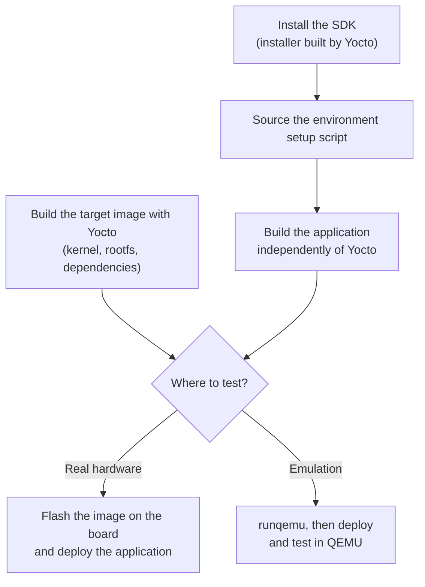
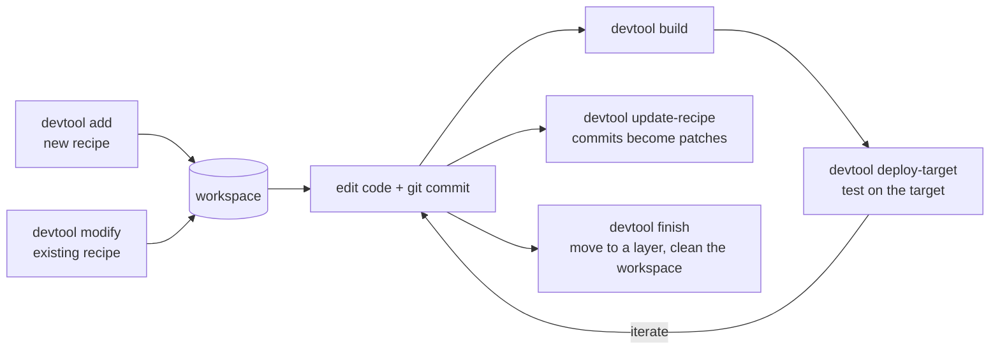

## Introduction

Working with the Yocto Project often means long build times: even a small application change can trigger a full system rebuild. Application developers, however, usually do not need to rebuild the entire platform. This is where the **SDK** becomes essential. It provides a preconfigured toolchain and sysroot, so developers can build and test applications independently from the Yocto build system. Separating platform development from application development makes iteration faster and the workflow more efficient.

In this article we explore the standard SDK, the extensible SDK (eSDK) and the `devtool` workflow. Each one addresses a specific need, from a stable cross-compilation environment to flexible, iterative development directly from source.

## What is a Yocto SDK?

A **toolchain** is a collection of development tools that run on one architecture (the *host*) to generate binaries for another architecture (the *target*). The SDK builds on this: it is a complete, self-contained development environment that includes the toolchain along with libraries, headers and debugging tools. It lets developers build, test and debug applications in a way that matches the target system.

SDKs are completely self-contained: the binaries are linked against their own copy of libc, so they do not depend on the libraries installed on the host.

> An SDK is tied to a specific `MACHINE` configuration. Building for different target architectures (for example ARM64 and ARM32) requires generating a separate SDK for each one, each with its own cross-compilation toolchain.
{: .prompt-info }

### Typical workflow



1. Obtain the SDK installer generated by the Yocto build system and install it on the development machine. It provides a self-contained cross-compilation environment: the toolchain and a sysroot matching the target architecture.
2. Source the SDK environment setup script and use it to build the application independently of the full Yocto build system.
3. In parallel, build the target image with Yocto to get a complete system image (kernel, root filesystem, dependencies).
4. To test on real hardware, flash the image onto the board and deploy the application.
5. Alternatively, use QEMU: run the system with `runqemu`, then deploy and test the application in a virtual environment for faster iteration.

There are two types of SDK in Yocto: the **standard SDK** and the **extensible SDK (eSDK)**.

## The standard SDK

The standard SDK provides a cross-compilation toolchain (compilers, linkers, libraries, headers) and a sysroot that mirrors the target system. Its role is to let application developers build, test and debug software for the target architecture without the full Yocto build system.

### 1. Building and running the SDK installer

- Make sure `MACHINE` matches your target hardware.
- If the SDK must run on a host architecture different from your current machine, set `SDKMACHINE` in `local.conf`. `SDKMACHINE` is the architecture of the machine where the SDK is **installed and used**, not the target architecture. It defaults to `x86_64`.
- Build the installer:

  ```bash
  bitbake <image> -c populate_sdk
  ```

  It includes a sysroot with the headers and libraries matching your target image.
- When the build is done, the installer is in `tmp/deploy/sdk/`.
- Run the installer, for example:

  ```bash
  ./poky-glibc-x86_64-core-image-sato-core2-64-toolchain-5.3.3.sh
  ```

### 2. Installed SDK directory

The installer produces this structure:

```text
install_dir/version/
├── buildinfo
├── environment-setup-target-poky-linux
├── site-config-target-poky-linux
├── sysroots/
│   ├── target-poky-linux/
│   │   ├── bin/  boot/  etc/  home/  lib/  media/  mnt/
│   │   └── proc/  run/  sbin/  sys/  tmp/  usr/  var/
│   └── host-pokysdk-linux/
│       ├── bin/  environment-setup.d/  etc/  lib/
│       └── sbin/  usr/  var/
└── version-target-poky-linux
```

| Path | Role |
|------|------|
| `environment-setup-<target>-poky-linux` | The script to **source** before using the SDK. It configures the cross-compilation environment (`CC`, `LD`, `CXX`, ...). |
| `sysroots/<target>-poky-linux` | A copy of the target root filesystem (`bin/`, `lib/`, `usr/`, `etc/`, ...) with the headers and libraries available on the target. For `#include <stdio.h>`, the compiler looks in `sysroots/<target>-poky-linux/usr/include`. |
| `sysroots/<host>-pokysdk-linux` | The tools that run on the host, e.g. `aarch64-poky-linux-gcc` and `aarch64-poky-linux-ld` in `bin/`. |

In short, sourcing the setup script sets the compiler (`CC`) to the cross-compiler in the host sysroot and defines the `SYSROOT` pointing to the target root filesystem. As a result:

- the compiler and build tools run from the **host** sysroot;
- headers and libraries come from the **target** sysroot, which guarantees compatibility with the target system.

This separation is fundamental in cross-compilation: you build on the host while linking against the target environment, so the binaries run correctly on the target.

### Example: build an application with the SDK

Initialize the build environment and build the SDK installer:

```bash
source oe-init-build-env
bitbake core-image-minimal -c populate_sdk
```

This generates an installer such as `poky-glibc-x86_64-core-image-minimal-cortexa57-qemuarm64-toolchain-5.0.13.sh`. Run it: by default the environment setup script ends up under `/opt/poky/`.

```text
Poky (Yocto Project Reference Distro) SDK installer version 5.0.13
Enter target directory for SDK (default: /opt/poky/5.0.13):
You are about to install the SDK to "/opt/poky/5.0.13". Proceed [Y/n]?
Extracting SDK...done
Setting it up...done
SDK has been successfully set up and is ready to be used.
Each time you wish to use the SDK in a new shell session, you need to source the environment setup script e.g.
 $ . /opt/poky/5.0.13/environment-setup-cortexa57-poky-linux
```

Source the setup script in the terminal you use for development. This must be repeated for **each new shell session**.

```bash
source /opt/poky/5.0.13/environment-setup-cortexa57-poky-linux
echo $CC
```

```text
aarch64-poky-linux-gcc -mcpu=cortex-a57+crc -mbranch-protection=standard -fstack-protector-strong -O2 -D_FORTIFY_SOURCE=2 -Wformat -Wformat-security -Werror=format-security --sysroot=/opt/poky/5.0.13/sysroots/cortexa57-poky-linux
```

- **Cross-compiler:** `aarch64-poky-linux-gcc` targets ARM64 (AArch64).
- **Target-specific optimization:** `-mcpu=cortex-a57+crc` optimizes for the target CPU (taken from the machine configuration in Yocto).
- **Sysroot:** `--sysroot` points to the target root filesystem, so the right headers and libraries are used.

We now build a small C application made of a header, a source file and a Makefile, then test it on QEMU.

`hello_sdk.h`:

```c
#ifndef HELLO_SDK_H
#define HELLO_SDK_H

void print_sdk_info(const char *message);

#endif /* HELLO_SDK_H */
```

`hello_sdk.c`:

```c
#include <stdio.h>
#include "hello_sdk.h"

void print_sdk_info(const char *message) {
    printf("Yocto SDK/eSDK Demo: %s\n", message);
}

int main(int argc, char *argv[]) {
    print_sdk_info("Successfully compiled with the Yocto SDK !");
    return 0;
}
```

`Makefile`:

```make
hello_sdk: hello_sdk.c hello_sdk.h
	$(CC) $(CFLAGS) hello_sdk.c -o hello_sdk

clean:
	rm -f hello_sdk
```

Running `make` shows that the SDK's cross-compiler is used:

```text
make
aarch64-poky-linux-gcc  -mcpu=cortex-a57+crc -mbranch-protection=standard -fstack-protector-strong  -O2 -D_FORTIFY_SOURCE=2 -Wformat -Wformat-security -Werror=format-security --sysroot=/opt/poky/5.0.13/sysroots/cortexa57-poky-linux  -O2 -pipe -g -feliminate-unused-debug-types  hello_sdk.c -o hello_sdk
```

The `file` command confirms that the binary targets ARM64: a dynamically linked ELF executable for Linux.

```text
file hello_sdk
hello_sdk: ELF 64-bit LSB pie executable, ARM aarch64, version 1 (SYSV), dynamically linked, interpreter /lib/ld-linux-aarch64.so.1, BuildID[sha1]=65e7bb9256d6307448b5cb6da270468c52c8e62e, for GNU/Linux 5.15.0, with debug_info, not stripped
```

Now deploy the binary to a running QEMU instance. SSH must be enabled in the target image to transfer the file:

```bash
scp hello_sdk root@192.168.7.4:/usr/bin/
```

```text
root@qemuarm64:~# /usr/bin/hello_sdk
Yocto SDK/eSDK Demo: Successfully compiled with the Yocto SDK !
```

## The extensible SDK

The Yocto **extensible SDK (eSDK)** extends the standard SDK with a more complete and flexible development environment. Besides cross-compiling applications, it lets developers generate and modify recipes, build individual recipes or full images, and deploy packages directly to the target. These features are mainly provided by the `devtool` utility, which is also available in a full Yocto build environment.

There are two ways to set up the eSDK: directly within a Yocto build environment, or with a standalone installer generated by Yocto.

### 1. An eSDK-like environment inside a Yocto build

In a typical SDK workflow you build an image and its SDK, install the SDK, then start developing. Here the approach differs: instead of installing an SDK, you use the Yocto build directory itself as a development environment, similar to an eSDK.

1. **Prepare the build environment:**

   ```bash
   source oe-init-build-env
   ```

2. **Generate the IDE support environment:**

   ```bash
   bitbake meta-ide-support
   ```

   This generates environment setup scripts (`environment-setup-<target>`) and prepares toolchain paths, sysroots and environment variables.

   > This step does not modify the current shell. You still need to source the generated script when needed.
   {: .prompt-warning }

3. **Populate the sysroot with the required packages:**

   ```bash
   bitbake -c populate_sysroot <package>
   ```

   This builds the package (if not already built), builds its dependencies, and installs headers, libraries and other development files into the sysroot, so all dependencies are available for development.

4. **Build complete sysroots for the host and the target:**

   ```bash
   bitbake build-sysroots -c build_native_sysroot
   bitbake build-sysroots -c build_target_sysroot
   ```

   The first command builds the **native** sysroot: tools and libraries that run on the host (compilers, build tools, utilities). The second builds the **target** sysroot: headers and libraries for the target architecture, aggregating every dependency needed to compile applications for the target device.

At this stage the Yocto build environment provides everything needed for development: toolchain, sysroots and dependencies.

#### Example

```bash
source oe-init-build-env build
bitbake build-sysroots -c build_native_sysroot
bitbake build-sysroots -c build_target_sysroot
bitbake meta-ide-support
```

`meta-ide-support` generates the environment setup script at `tmp/deploy/images/<machine>/environment-setup-<target>-poky-linux`. For `MACHINE = "qemuarm64"`:

```bash
source tmp/deploy/images/qemuarm64/environment-setup-qemuarm64-poky-linux
```

This configures `CC`, `CXX`, `LD`, `PATH`, etc.

To keep the build directory clean and clearly separate the Yocto build system from application development, we source the script from the directory where the application lives:

```bash
mkdir ~/yocto-dev
cd ~/yocto-dev/
source <yocto-build-dir>/tmp/deploy/images/qemuarm64/environment-setup-qemuarm64-poky-linux
```

Check `$CC`:

```text
echo ${CC}
aarch64-poky-linux-gcc -mcpu=cortex-a57+crc -mbranch-protection=standard -fstack-protector-strong -O2 -D_FORTIFY_SOURCE=2 -Wformat -Wformat-security -Werror=format-security --sysroot=/home/rahma/yocto-project/build/tmp/sysroots/qemuarm64
```

- `aarch64-poky-linux-gcc` is the cross-compiler: `aarch64` is the target architecture (ARM 64-bit), `poky-linux` the Yocto toolchain, `gcc` the compiler.
- `-mcpu=cortex-a57+crc` optimizes for the target CPU (set in `qemuarm64.conf`).
- `--sysroot=...` is where the compiler looks for headers and libraries. For `#include <stdio.h>` it uses `.../tmp/sysroots/qemuarm64/usr/include/stdio.h`.

After sourcing the script, `CC` uses the Yocto cross-compiler with all required flags and the right sysroot, as if the code were compiled directly on the target.

In the same development directory, we rebuild the previous application (same `hello_sdk.h`, `hello_sdk.c` and `Makefile`):

```text
make
aarch64-poky-linux-gcc  -mcpu=cortex-a57+crc -mbranch-protection=standard -fstack-protector-strong  -O2 -D_FORTIFY_SOURCE=2 -Wformat -Wformat-security -Werror=format-security --sysroot=/home/rahma/yocto-project/build/tmp/sysroots/qemuarm64  -O2 -pipe -g -feliminate-unused-debug-types  hello_sdk.c -o hello_sdk
```

```text
file hello_sdk
hello_sdk: ELF 64-bit LSB pie executable, ARM aarch64, version 1 (SYSV), dynamically linked, interpreter /lib/ld-linux-aarch64.so.1, BuildID[sha1]=26fa7790038eb1c538ae22b335f14fc9039f41b5, for GNU/Linux 5.15.0, with debug_info, not stripped
```

Test in QEMU:

```bash
runqemu qemuarm64 nographic
scp hello_sdk root@192.168.7.4:/usr/bin/
```

```text
root@qemuarm64:~# which hello_sdk
/usr/bin/hello_sdk
root@qemuarm64:~# /usr/bin/hello_sdk
Yocto SDK/eSDK Demo: Successfully compiled with the Yocto SDK
```

### 2. Setting up the eSDK with an installer

**Building the eSDK installer.** The steps are similar to the standard SDK. The differences:

- the build command is

  ```bash
  bitbake <image> -c populate_sdk_ext
  ```

- the installer is an extensible SDK that includes extra metadata and tools (such as `devtool`) to modify, rebuild and deploy recipes;
- the installer name typically contains the `-toolchain-ext-` suffix.

Everything else (setting `MACHINE` and `SDKMACHINE`, installer location in `tmp/deploy/sdk`, sourcing the environment setup script) stays the same as for the standard SDK.

**Installed eSDK directory.** The installed eSDK contains a minimal embedded Yocto/OpenEmbedded build system. Unlike the standard SDK, there is no strict host/target sysroot separation, because the eSDK includes a self-contained copy of the OpenEmbedded build environment. This lets you modify recipes, rebuild components and manage builds directly inside the SDK.

```text
install_dir/
├── bitbake-cookerdaemon.log
├── buildinfo
├── buildtools/
├── cache/
├── conf/
├── .devtoolbase
├── downloads/
├── environment-setup-target-poky-linux
├── layers/
├── oe-time-dd-test.dat
├── preparing_system_build.log
├── site-config-target-poky-linux
├── sstate-cache/
├── sysroots/
├── tmp/
├── version-target-poky-linux
└── workspace/
```

`site-config-<target>-poky-linux` holds the target-specific configuration: target architecture, compilation options and system-level build parameters used by the SDK environment.

## The devtool command

`devtool` is a key Yocto utility for application and recipe development. It is often associated with the eSDK, but it is not limited to it: it is part of the core Yocto Project and is available as soon as the build environment is initialized with `source oe-init-build-env`.

**So why is devtool mainly associated with the eSDK?** Because of the usage context.

- In a full Yocto build environment you have the whole build system: BitBake, layers, configurations. `devtool` is just one tool among many, optional but convenient.
- In the eSDK the full build system is not directly exposed: you do not have direct access to every layer or to the complete build infrastructure. `devtool` becomes the **primary interface** for modifying code, generating recipes, rebuilding components and deploying to the target. It is essential and central there.

With `devtool` you can add new recipes, modify existing ones, deploy packages into your image for testing, and more. Each feature has its own command: `devtool add`, `devtool modify`, `devtool deploy-target`, etc.

`devtool` uses a **workspace layer** to do its builds. This layer is not specific to any command; it is a common working area shared across the tool.



### Adding a new recipe

```bash
devtool add <recipename> <srctree_or_fetchuri>
```

- `<recipename>` is the name of the new recipe.
- `<srctree_or_fetchuri>` is the path to a local source directory or a remote URI (for example a Git repository URL).

> - The recipe name must not already exist in the current workspace or layers.
> - The source code must already be available, locally or from a remote Git repository.
{: .prompt-warning }

`devtool` manages the source differently depending on its origin:

- **Local source directory:** `devtool` does **not** copy the code. It keeps a reference to the original location through `EXTERNALSRC`, typically set in the `.bbappend` file.
- **Remote Git repository:** `devtool` clones it into `workspace/sources/<recipe-name>/`, and the source is then managed locally in the workspace.

`devtool add` creates this structure in the workspace:

```text
workspace/
├── sources/
│   └── <recipe-name>/
│       ├── (source code of the application)
│       ├── src/
│       ├── include/
│       ├── Makefile / CMakeLists.txt
│       └── ...
└── recipes/
    └── <recipe-name>/
        ├── <recipe-name>.bb
        └── <recipe-name>.bbappend
```

The `.bbappend` is usually used to override the source path (`EXTERNALSRC`):

```bitbake
EXTERNALSRC = "/home/user/my-app"
EXTERNALSRC_BUILD = "${WORKDIR}"
```

This tells BitBake to use the external source directory instead of copying the code into the Yocto build system.

### Modifying an existing recipe

```bash
devtool modify <recipe-name>
```

Use it when the recipe already exists in a Yocto layer (such as `meta`). The main steps:

1. Retrieve the source code defined by the recipe's `SRC_URI`.
2. Place it in the workspace: `workspace/sources/<recipe>`. You now have a local editable copy of the project.
3. Initialize a Git repository (`git init`) to track changes, create commits and manage patches cleanly.
4. Create a working branch in the workspace (usually named `devtool`).
5. Apply the existing patches. Recipes often ship `.patch` files, and `devtool modify` applies them as Git commits.

`devtool modify` also creates a `.bbappend` in the workspace. It overrides the recipe's behavior without changing the original, through this key line:

```bitbake
EXTERNALSRC = "workspace/sources/recipe"
```

BitBake then compiles the workspace version of the code instead of the original one, which allows fast development and testing.

### Updating an existing recipe

```bash
devtool update-recipe <recipe-name>
```

It converts your code changes into patches and integrates them into the recipe. The complete workflow:

1. `devtool modify recipe` brings the source into your local workspace (a Git working area).
2. Edit the code in `workspace/sources/recipe/`.
3. Commit your changes:

   ```bash
   git add .
   git commit -m "fix bug"
   ```

4. Run `devtool update-recipe recipe`: it creates the patches and updates the recipe.

> If you do **not** commit your changes, nothing happens, because `devtool` relies on Git commits to detect what changed.
{: .prompt-warning }

`devtool update-recipe` analyzes your Git commits, compares the original source with your commits and generates `.patch` files automatically. Each commit becomes a patch file (for example `0001-fix-bug.patch`). It then updates the recipe to include the patches, usually with `SRC_URI += "file://0001-fix-bug.patch"`.

**Where do patches go?**

- Without the `-a` option, patches are added inside the recipe's own layer.
- With `devtool update-recipe recipe -a meta-my-layer`, a `.bbappend` is created in **your custom layer** and the patches are stored there, instead of modifying the official layers.

```text
/path/to/custom/layer/
└── recipes-xxx/
    └── recipe/
        ├── recipe.bbappend (or .bb)
        └── patches/
```

We use `-a` to avoid touching the official Yocto layers and to keep changes clean and maintainable. The `.bbappend` extends the original recipe (for example `SRC_URI += "file://0001-fix.patch"`): the original recipe stays unchanged and your patch is applied on top.

In short:

- `devtool modify` brings the source into the workspace;
- you modify the code locally;
- you commit the changes with Git;
- `devtool update-recipe` converts the commits into patches;
- the `.bbappend` ensures a clean integration without touching upstream layers.

### Finishing work on a recipe

```bash
devtool finish <recipe> <layerpath>
```

`devtool finish` finalizes your work by integrating it into a layer and cleaning the workspace. Running `devtool finish recipe /path/to/custom/layer` does three things:

1. It generates patches (like `update-recipe`): your Git commits become `.patch` files and the recipe is updated accordingly.
2. It adds everything to your target layer (recipe, patches).
3. It cleans the workspace by removing the workspace `.bbappend`, the `EXTERNALSRC` link and the temporary "dev" version of the recipe.

You are then back to a standard Yocto build environment.

> As with `update-recipe`, you **must commit** your changes. If you don't, nothing is applied.
{: .prompt-warning }

- **Before `finish`** you are in development mode: `EXTERNALSRC`, working inside the workspace.
- **After `finish`** you are in production Yocto mode: reproducible builds, clean integration, shareable layers.

### Building your recipe

```bash
devtool build <recipe>
```

It builds a recipe directly from the `devtool` workspace, without going through the classic BitBake workflow. After `devtool modify` or `devtool add`, the workspace contains your recipe and your editable source code, and `devtool build` compiles from there:

- `bitbake <recipe>` builds from the standard Yocto layers;
- `devtool build <recipe>` builds from your workspace, with your local modifications.

It uses the source in `workspace/sources/<recipe>` and the recipe in `workspace/recipes/<recipe>`, and runs the usual BitBake tasks: compile, install, package.

The output can be deployed and tested on the target, but this command does not integrate the recipe permanently into a layer and does not replace BitBake. It is for temporary testing during development, not final integration.

### Deploying your recipe

```bash
devtool deploy-target <recipe> user@target-ip
```

This command deploys a compiled application directly to a target machine over SSH. It:

- connects to the target via SSH;
- copies the files produced by the `do_install` task;
- installs the application directly on the target, **bypassing the package manager**.

> - It does **not** install runtime dependencies: everything required must already be on the target.
> - It is meant for development and testing only, not for production.
{: .prompt-warning }

## Example 1: devtool add from a GitHub repository

We use a small application made of a source file and a header that displays build information.

`config.h`:

```c
#ifndef CONFIG_H
#define CONFIG_H

#define APP_NAME          "BUILD-INFO-APP"
#define APP_VERSION       "1.0.0"
#define APP_AUTHOR        "Rahma Rahali"
#define APP_DESCRIPTION   "A simple application to display build information."
#define TARGET_BOARD      "Raspberry Pi 4"
#define DEBUG_MODE        1
#define LOG_LEVEL         3

#endif // CONFIG_H
```

`build-info.c`:

```c
#include <stdio.h>
#include "config.h"

int main(void) {

    printf("================ Build Information: ================\n");

#ifdef APP_NAME
    printf("Application Name: %s\n", APP_NAME);
#endif
#ifdef APP_VERSION
    printf("Version: %s\n", APP_VERSION);
#endif
#ifdef APP_AUTHOR
    printf("Author: %s\n", APP_AUTHOR);
#endif
#ifdef APP_DESCRIPTION
    printf("Description: %s\n", APP_DESCRIPTION);
#endif
#ifdef TARGET_BOARD
    printf("Target Board: %s\n", TARGET_BOARD);
#endif
#ifdef DEBUG_MODE
    printf("Debug Mode: %s\n", DEBUG_MODE ? "Enabled" : "Disabled");
#endif
#ifdef LOG_LEVEL
    printf("Log Level: %d\n", LOG_LEVEL);
#endif

    printf("====================================================\n");

    return 0;
}
```

Create the recipe from the repository:

```bash
devtool add build-info https://github.com/rahma145/devtool-yocto.git
```

This creates a recipe named `build-info` from a GitHub repository and adds it to the workspace. At the end, a message tells where the recipe was created:

```text
INFO: Fetching git://github.com/rahma145/devtool-yocto.git;protocol=https;branch=master...
...
INFO: Using default source tree path /home/rahma/yocto-project/build/workspace/sources/build-info
...
INFO: Recipe /home/rahma/yocto-project/build/workspace/recipes/build-info/build-info_git.bb has been automatically created; further editing may be required to make it fully functional
```

Inside the build directory, the workspace looks like this:

```text
workspace
├── appends
│   └── build-info_git.bbappend
├── conf
│   └── layer.conf
├── README
├── recipes
│   └── build-info
│       └── build-info_git.bb
└── sources
    └── build-info
        ├── build-info.c
        └── config.h
```

`build-info_git.bbappend` configures `EXTERNALSRC` and `EXTERNALSRC_BUILD` so the build system uses the local source directory in the workspace:

```bitbake
inherit externalsrc
EXTERNALSRC = "/home/rahma/yocto-project/build/workspace/sources/build-info"
EXTERNALSRC_BUILD = "/home/rahma/yocto-project/build/workspace/sources/build-info"

# initial_rev .: 73aadab0a0d3d51ee881cf5e16a0674820f750d6
```

`build-info_git.bb` as generated. It is **not complete**: `devtool add` only provides a basic structure, and it is up to the developer to complete and refine it.

```bitbake
# Recipe created by recipetool
# This is the basis of a recipe and may need further editing in order to be fully functional.
# (Feel free to remove these comments when editing.)

# Unable to find any files that looked like license statements. Check the accompanying
# documentation and source headers and set LICENSE and LIC_FILES_CHKSUM accordingly.
#
# NOTE: LICENSE is being set to "CLOSED" to allow you to at least start building - if
# this is not accurate with respect to the licensing of the software being built (it
# will not be in most cases) you must specify the correct value before using this
# recipe for anything other than initial testing/development!
LICENSE = "CLOSED"
LIC_FILES_CHKSUM = ""

SRC_URI = "git://github.com/rahma145/devtool-yocto.git;protocol=https;branch=master"

# Modify these as desired
PV = "1.0+git"
SRCREV = "73aadab0a0d3d51ee881cf5e16a0674820f750d6"

S = "${WORKDIR}/git"

# NOTE: no Makefile found, unable to determine what needs to be done

do_configure () {
	# Specify any needed configure commands here
	:
}

do_compile () {
	# Specify compilation commands here
	:
}

do_install () {
	# Specify install commands here
	:
}
```

After applying our modifications:

```bitbake
LICENSE = "CLOSED"
LIC_FILES_CHKSUM = ""

SRC_URI = "git://github.com/rahma145/devtool-yocto.git;protocol=https;branch=master"

# Modify these as desired
PV = "1.0+git"
SRCREV = "73aadab0a0d3d51ee881cf5e16a0674820f750d6"

S = "${WORKDIR}/git"

do_compile () {
	${CC} build-info.c -o build-info
}

do_install () {
	install -d ${D}/usr/bin
	install -m 0744 build-info ${D}/usr/bin
}
```

> `${D}` is the destination directory (staging rootfs). It is **not** your real system but a "fake" root filesystem used during packaging: `${D}/usr/bin/build-info` is later copied into the real image's `/usr/bin`.
{: .prompt-info }

Build the recipe:

```bash
devtool build build-info
```

The workspace is modified by the build: the `build-info` binary appears in the source tree, along with the `{D}` staging directory and links to the BitBake logs and work directory.

```text
workspace/
├── appends
│   └── build-info_git.bbappend
├── conf
│   └── layer.conf
├── README
├── recipes
│   └── build-info
│       └── build-info_git.bb
└── sources
    └── build-info
        ├── build-info
        ├── build-info.c
        ├── config.h
        ├── {D}
        │   └── usr
        │       └── bin
        ├── oe-logs -> /home/rahma/yocto-project/build/tmp-glibc/work/cortexa72-oe-linux/build-info/1.0+git/temp
        └── oe-workdir -> /home/rahma/yocto-project/build/tmp-glibc/work/cortexa72-oe-linux/build-info/1.0+git
```

Deploy the application to a running QEMU:

```bash
devtool deploy-target build-info root@192.168.7.2
```

```text
Are you sure you want to continue connecting (yes/no/[fingerprint])?
INFO: Successfully deployed /home/rahma/yocto-project/build/tmp-glibc/work/cortexa57-oe-linux/build-info/1.0+git/image
```

> `devtool deploy-target` relies on the build context generated by `devtool build`. If this context is lost (for example after opening a new terminal), the deploy step may fail because it cannot locate the installed files.
{: .prompt-warning }

Run the binary from QEMU:

```text
root@qemuarm64:/usr/bin# find . -name "build-info"
./build-info
root@qemuarm64:/usr/bin# ./build-info
================ Build Information: ================
Application Name: BUILD-INFO-APP
Version: 1.0.0
Author: Rahma Rahali
Description: A simple application to display build information.
Target Board: Raspberry Pi 4
Debug Mode: Enabled
Log Level: 3
====================================================
```

Finish working on the recipe:

```bash
devtool finish build-info ../meta-project/
```

```text
ERROR: Source tree is not clean:

?? build-info

Ensure you have committed your changes or use -f/--force if you are sure there's nothing that needs to be committed
```

As explained earlier, `devtool finish` needs a clean Git repository with every change committed. Here the `build-info` binary is untracked, so we commit a `.gitignore` first:

```bash
cd workspace/sources/build-info
echo "build-info" >> .gitignore
git add .gitignore
git commit -m "Ignore build artifacts"
devtool finish build-info ../../../../meta-project/
```

```text
INFO: Adding new patch 0001-Ignore-build-artifacts.patch
INFO: Updating recipe build-info_git.bb
INFO: Moving recipe file to /home/rahma/yocto-project/meta-project/recipes-build-info/build-info
INFO: Preserving source tree in /home/rahma/yocto-project/build/workspace/attic/sources/build-info.20260407212015
If you no longer need it then please delete it manually.
It is also possible to reuse it via devtool source tree argument.
```

The `build-info` recipe is now correctly added to the `meta-project` layer:

```text
meta-project/
├── conf
│   └── layer.conf
├── COPYING.MIT
├── README
├── recipes-build-info
│   └── build-info
│       ├── build-info
│       │   └── 0001-Ignore-build-artifacts.patch
│       └── build-info_git.bb
└── recipes-example
    └── example
        └── example_0.1.bb
```

The layer now contains a clean recipe plus a patch generated from our work in the workspace. We moved from local development (workspace) to clean integration into a Yocto layer. When running `devtool finish`, Yocto took the Git repository, extracted the commits, generated the patches, copied the recipe and cleaned the workspace.

## Example 2: devtool modify and update-recipe on zlib

Here we use `devtool modify` and `devtool update-recipe` on the **zlib** library.

### devtool modify

In `poky/meta/recipes-core/zlib/zlib/` there is an existing patch, `0001-configure-Pass-LDFLAGS-to-link-tests.patch`. When running `devtool modify zlib`, this patch is automatically applied and converted into a Git commit inside the workspace source tree. You can then inspect and modify the patched code with a standard Git workflow instead of dealing with patch files.

```bash
devtool modify zlib
```

```text
INFO: Adding local source files to srctree...
INFO: Source tree extracted to /home/rahma/yocto-project/build/workspace/sources/zlib
INFO: Recipe zlib now set up to build from /home/rahma/yocto-project/build/workspace/sources/zlib
```

In `workspace/sources/zlib`, `devtool modify` initialized a Git repository and created a branch named `devtool`. It applied the existing recipe patch as a Git commit:

```bash
git branch
git log
```

```text
commit 6d0fbfc441d4ed8a3bda15b23185bd6df03486e8 (HEAD -> devtool, tag: devtool-patched)
Author: Khem Raj <raj.khem@gmail.com>
Date:   Tue Mar 8 22:38:47 2022 -0800

    configure: Pass LDFLAGS to link tests

    Upstream-Status: Submitted [https://github.com/madler/zlib/pull/599]
    Signed-off-by: Ross Burton <ross.burton@arm.com>
    ...

Notes (devtool):
    original patch: 0001-configure-Pass-LDFLAGS-to-link-tests.patch
```

A `.bbappend` is also created at `workspace/appends/zlib_1.3.1.bbappend`:

```bitbake
FILESEXTRAPATHS:prepend := "${THISDIR}/${PN}:"
FILESPATH:prepend := "/home/rahma/yocto-project/build/workspace/sources/zlib/oe-local-files:"
# srctreebase: /home/rahma/yocto-project/build/workspace/sources/zlib

inherit externalsrc
# NOTE: We use pn- overrides here to avoid affecting multiple variants in the case where the recipe uses BBCLASSEXTEND
EXTERNALSRC:pn-zlib = "/home/rahma/yocto-project/build/workspace/sources/zlib"
```

- `FILESEXTRAPATHS:prepend := "${THISDIR}/${PN}:"` adds a search path for patches and extra files (`file://...`) relative to the `.bbappend` location.
- `FILESPATH:prepend := ".../workspace/sources/zlib/oe-local-files:"` adds a directory where Yocto looks for local files such as temporary patches.
- `EXTERNALSRC:pn-zlib = ".../workspace/sources/zlib"` redirects the build system to the local source tree instead of the original recipe sources.

Overall, this `.bbappend` configures Yocto to use the local workspace, manage patches and build directly from the external source directory.

### devtool update-recipe

Before running it, we modify a file in `workspace/sources/zlib/` by adding a simple line:

```c
printf("Custom debug from zlib\n");
```

Then, in `workspace/sources/zlib/`:

```bash
git add .
git commit -m "Add debug message"
```

Generate the patch (we use `-a` to avoid modifying the original recipe):

```bash
devtool update-recipe zlib -a ../meta-project/
```

```text
NOTE: Writing append file /home/rahma/yocto-project/meta-project/recipes-core/zlib/zlib_%.bbappend
NOTE: Copying 0001-Add-debug-message.patch to /home/rahma/yocto-project/meta-project/recipes-core/zlib/zlib/0001-Add-debug-message.patch
INFO: Cleaning sysroot for recipe zlib...
```

The `meta-project` layer now reflects the changes made to the zlib source:

```text
meta-project/
├── conf
│   └── layer.conf
├── COPYING.MIT
├── README
├── recipes-build-info
│   └── build-info
│       ├── build-info
│       │   └── 0001-Ignore-build-artifacts.patch
│       └── build-info_git.bb
├── recipes-core
│   └── zlib
│       ├── zlib
│       │   └── 0001-Add-debug-message.patch
│       └── zlib_1.3.1.bbappend
└── recipes-example
    └── example
        └── example_0.1.bb
```

A new patch, `0001-Add-debug-message.patch`, was generated from the changes in the workspace. It sits under the zlib recipe directory and is integrated automatically through the corresponding `.bbappend`.

The `.bbappend` extends the original zlib recipe without modifying it:

```bitbake
FILESEXTRAPATHS:prepend := "${THISDIR}/${PN}:"

SRC_URI += "file://0001-Add-debug-message.patch"
```

First, `FILESEXTRAPATHS:prepend` adds a search path so BitBake can find extra files such as patches in the directory where the `.bbappend` is stored. Then `SRC_URI += "file://0001-Add-debug-message.patch"` appends the generated patch to the recipe's sources, so the modification made in the workspace is applied during the build.

`0001-Add-debug-message.patch`:

```diff
From 62acb153b1bb725f8d2cd67aef4f4ff466b65683 Mon Sep 17 00:00:00 2001
From: rahma145 <rahma.rahali@ensi-uma.tn>
Date: Sun, 26 Apr 2026 11:28:41 +0100
Subject: [PATCH] Add debug message

---
 gzlib.c | 1 +
 1 file changed, 1 insertion(+)

diff --git a/gzlib.c b/gzlib.c
index 983153c..dd567f5 100644
--- a/gzlib.c
+++ b/gzlib.c
@@ -27,6 +27,7 @@
    The gz_strwinerror function does not change the current setting of
    GetLastError. */
 char ZLIB_INTERNAL *gz_strwinerror(DWORD error) {
+    printf("Custom debug from zlib\n");
     static char buf[1024];

     wchar_t *msgbuf;
```

### Build and deploy

Build zlib from the workspace:

```bash
devtool build zlib
```

```text
NOTE: zlib: compiling from external source tree /home/rahma/yocto-project/build/workspace/sources/zlib
NOTE: Tasks Summary: Attempted 768 tasks of which 745 didn't need to be rerun and all succeeded.
```

Deploy the library to QEMU. Before `devtool deploy-target`:

```text
root@qemuarm64:~# ls /usr/lib | grep zlib
root@qemuarm64:~#
```

```bash
devtool deploy-target zlib root@192.168.7.2
```

```text
INFO: Successfully deployed /home/rahma/yocto-project/build/tmp/work/cortexa57-poky-linux/zlib/1.3.1/image
```

After the deployment:

```text
root@qemuarm64:~# ls /usr/lib | grep zlib
zlib
```

Finally, finish working on zlib to clean the workspace:

```bash
devtool finish zlib ../../meta-project
```

## Conclusion

In this article we covered the key `devtool` commands used in Yocto development:

| Command | Purpose |
|---------|---------|
| `devtool add` | Create a new recipe from a source tree or URI |
| `devtool modify` | Bring an existing recipe's source into the workspace |
| `devtool update-recipe` | Turn Git commits into patches and update the recipe |
| `devtool build` | Build a recipe from the workspace |
| `devtool deploy-target` | Deploy the result to the target over SSH |
| `devtool finish` | Integrate into a layer and clean the workspace |

These cover the most common workflows for adding, modifying, building and deploying recipes during application development. `devtool` offers many more features for advanced scenarios; for a complete overview, refer to the official Yocto Project documentation.
